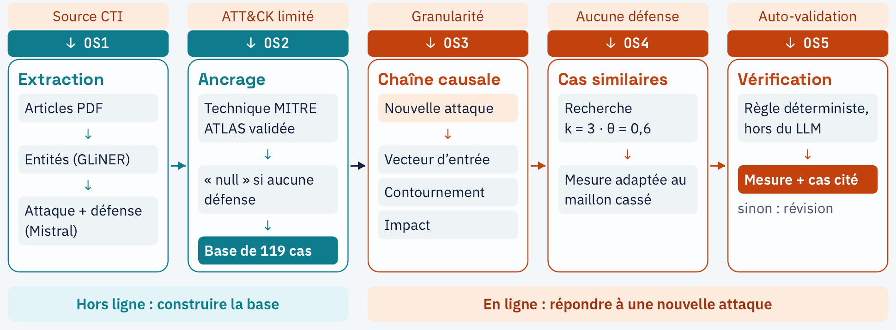
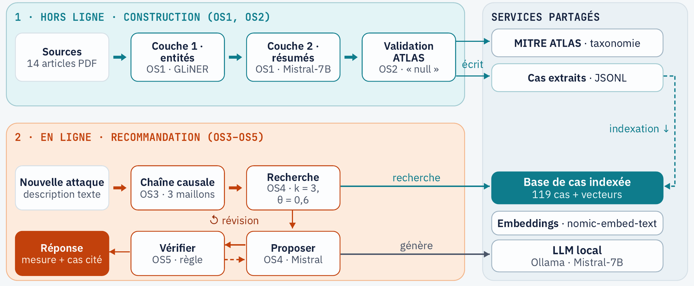

# Page de garde

---

**MÉMOIRE** présenté en vue de l'obtention du **Diplôme de Mastère de Recherche en Informatique**

Parcours : Smart Systems & IoT

**Sujet : Nexus Intel : De la Publication à la Protection — Synthèse Automatisée des Défenses contre les Menaces Émergentes sur les LLM**

Élaboré par : **Souhir AYARI** · Laboratoire LARIA · ENSI, Université de la Manouba

Encadrante : Dr Amal TARIFA, Maître Assistante · Année universitaire 2025/2026

---

# Table des matières

---

- Introduction générale
- Chapitre 1 — Problématique
  - 1.1 Du constat au problème
  - 1.2 Les difficultés à surmonter
    - 1.2.1 Extraire des connaissances fiables à partir d'articles hétérogènes
    - 1.2.2 Ancrer chaque attaque dans une taxonomie adaptée
    - 1.2.3 Décrire l'attaque avec une granularité suffisante
    - 1.2.4 Maîtriser les hallucinations et vérifier les recommandations
  - 1.3 Question de recherche
  - 1.4 Conclusion
- Chapitre 2 — État de l'art
  - 2.1 CTINexus : construction de graphes de connaissances CTI par apprentissage en contexte
    - 2.1.1 Principe
    - 2.1.2 Méthodologie et techniques utilisées
    - 2.1.3 Contributions et résultats
    - 2.1.4 Limites
  - 2.2 LADDER : extraction de schémas d'attaque reliés à MITRE ATT&CK
    - 2.2.1 Principe
    - 2.2.2 Méthodologie et techniques utilisées
    - 2.2.3 Contributions et résultats
    - 2.2.4 Limites
  - 2.3 FALCON : génération de règles de détection à partir de la CTI
    - 2.3.1 Principe
    - 2.3.2 Méthodologie et techniques utilisées
    - 2.3.3 Contributions et résultats
    - 2.3.4 Limites
  - 2.4 TechniqueRAG : classification des techniques d'attaque par génération augmentée
    - 2.4.1 Principe
    - 2.4.2 Méthodologie et techniques utilisées
    - 2.4.3 Contributions et résultats
    - 2.4.4 Limites
  - 2.5 ATAG : graphes d'attaque et base de vulnérabilités des LLM
    - 2.5.1 Principe
    - 2.5.2 Méthodologie et techniques utilisées
    - 2.5.3 Contributions et résultats
    - 2.5.4 Limites
  - 2.6 Self-Refine : amélioration itérative par auto-évaluation
    - 2.6.1 Principe
    - 2.6.2 Méthodologie et techniques utilisées
    - 2.6.3 Contributions et résultats
    - 2.6.4 Limites
  - 2.7 Autres travaux connexes
  - 2.8 Conclusion
- Chapitre 3 — Synthèse critique, positionnement et contributions
  - 3.1 Critères de comparaison
  - 3.2 Comparaison des approches avec CARL
  - 3.3 Limites de l'état de l'art
    - 3.3.1 L1 — Des connaissances tirées de rapports CTI plutôt que de la littérature scientifique
    - 3.3.2 L2 — Une taxonomie inadaptée aux attaques contre les LLM
    - 3.3.3 L3 — Une granularité limitée aux entités ou aux techniques
    - 3.3.4 L4 — Peu de défenses, et une vérification confiée au modèle
    - 3.3.5 L5 — Une traçabilité rarement assurée et des erreurs évaluées étape par étape
  - 3.4 Positionnement
  - 3.5 Contributions
    - 3.5.1 Contribution 1 : une approche de recommandation de défenses vérifiables
    - 3.5.2 Contribution 2 : une mesure de la propagation des erreurs d'une étape à l'autre
  - 3.6 Conclusion
- Chapitre 4 — Objectifs et méthodologie
  - 4.1 Objectifs
    - 4.1.1 Objectif général
    - 4.1.2 Objectifs spécifiques
    - 4.1.3 Périmètre
  - 4.2 Pipeline global de CARL
    - 4.2.1 Principe : le raisonnement à partir de cas
    - 4.2.2 Deux phases : construire la base, puis répondre
  - 4.3 Architecture et mise en œuvre
    - 4.3.1 Vue d'ensemble
    - 4.3.2 Prétraitement des articles
    - 4.3.3 Couche 1 : extraction des entités
    - 4.3.4 Couche 2 : résumé de l'attaque et de la défense
    - 4.3.5 Validation de la technique MITRE ATLAS
    - 4.3.6 Score de généralisabilité
    - 4.3.7 Déduplication et construction de la base de cas
    - 4.3.8 Recherche des cas similaires
    - 4.3.9 Chaîne causale, proposition et adaptation
    - 4.3.10 Vérification par une règle déterministe
    - 4.3.11 Environnement de mise en œuvre
  - 4.4 Conclusion
- Chapitre 5 — Évaluations
  - 5.1 Données
    - 5.1.1 Corpus scientifique
    - 5.1.2 Constitution de la base de cas
    - 5.1.3 Jeux de données de test
  - 5.2 Protocole expérimental
    - 5.2.1 Principe de l'évaluation
    - 5.2.2 Mesures utilisées à chaque étape
  - 5.3 Extraction des entités
    - 5.3.1 Choix de l'extracteur
    - 5.3.2 Contribution des filtres
    - 5.3.3 Limite de l'annotation
  - 5.4 Classification : validité et exactitude (RQ1)
    - 5.4.1 Objectif de l'expérience
    - 5.4.2 Résultats de la classification
    - 5.4.3 Analyse des erreurs
    - 5.4.4 Discussion des résultats
  - 5.5 RQ2 — Évaluation de la récupération des cas similaires
    - 5.5.1 Objectif de l'expérience
    - 5.5.2 Résultats de la récupération
    - 5.5.3 Impact des erreurs de classification sur la récupération
    - 5.5.4 Détection des attaques hors corpus
    - 5.5.5 Discussion des résultats
  - 5.6 RQ3 — Évaluation de la qualité et de la vérification des recommandations de défense
    - 5.6.1 Objectif de l'expérience
    - 5.6.2 Comparaison des différentes configurations
    - 5.6.3 Évaluation de l'ancrage et de la cohérence causale
    - 5.6.4 Évaluation humaine des recommandations
    - 5.6.5 Discussion des résultats
  - 5.7 Synthèse globale des résultats expérimentaux
    - 5.7.1 Synthèse des réponses aux questions de recherche
    - 5.7.2 Analyse de la propagation des erreurs
    - 5.7.3 Conclusion
- Chapitre 6 — Discussion et limites
  - 6.1 Interprétation des résultats : la substitution de *proxies*
  - 6.2 Réponse à la problématique
  - 6.3 Apports par rapport à l'état de l'art
  - 6.4 Compromis entre couverture et solidité
  - 6.5 Limites
  - 6.6 Conclusion
- Conclusion générale et perspectives
- Références bibliographiques
- Résumé
- Abstract

---

# Liste des figures

---

- Figure 4.1 — Pipeline global de CARL : de chaque limite de l'état de l'art à l'étape qui y répond
- Figure 4.2 — Architecture de CARL : construction hors ligne, recommandation en ligne et services partagés

---

# Liste des tableaux

---

- Tableau 3.1 — Comparaison des approches de l'état de l'art avec CARL (notre analyse ; n.r. : non rapporté)
- Tableau 3.2 — Réponse de CARL aux limites de l'état de l'art (section 3.3)
- Tableau 4.1 — Des limites de l'état de l'art aux étapes de CARL
- Tableau 4.2 — Composants, outils et paramètres de CARL
- Tableau 5.1 — Articles arXiv ajoutés au corpus, par famille d'attaques
- Tableau 5.2 — Du corpus à la base de cas : effectifs à chaque étape (rapporté)
- Tableau 5.3 — Jeux de données de test et étape évaluée
- Tableau 5.4 — Protocole d'évaluation par étape
- Tableau 5.5 — Comparaison des extracteurs de la couche 1 sur l'annotation manuelle (45 entités) (rapporté)
- Tableau 5.6 — Contribution de chaque filtre (Mistral-7B, variante thématique) (rapporté)
- Tableau 5.7 — Résultats de la classification (rapporté)
- Tableau 5.8 — Récupération sur les 14 requêtes couvertes (rapporté)
- Tableau 5.9 — Qualité des recommandations sur la base automatique (13 requêtes couvertes) (rapporté)
- Tableau 5.10 — Synthèse des réponses aux questions de recherche

---

# Liste des acronymes

---

| Sigle | Signification |
|---|---|
| **ATLAS** | *Adversarial Threat Landscape for Artificial-Intelligence Systems* (MITRE), base de connaissances des techniques d'attaque visant les systèmes d'IA |
| **ATT&CK** | *Adversarial Tactics, Techniques, and Common Knowledge* (MITRE), base de connaissances des techniques d'attaque informatiques |
| **BERT** | *Bidirectional Encoder Representations from Transformers*, famille de modèles de langage encodeurs |
| **CARL** | *Case-based Attack Remediation for LLMs*, l'approche proposée dans ce mémoire |
| **CBR** | *Case-Based Reasoning*, raisonnement à partir de cas : retrouver un cas passé similaire, réutiliser sa solution, la réviser et la conserver |
| **CTI** | *Cyber Threat Intelligence*, renseignement sur les menaces : rapports qui décrivent les menaces et les attaques observées |
| **IA** | Intelligence artificielle |
| **IDS** | *Intrusion Detection System*, système de détection d'intrusion |
| **IoC** | *Indicator of Compromise*, indicateur de compromission (adresse IP, nom de domaine, empreinte de fichier…) |
| **JSONL** | *JSON Lines*, format de fichier qui contient un enregistrement JSON par ligne |
| **LLM** | *Large Language Model*, grand modèle de langage |
| **LVD** | *LLM Vulnerability Database*, base de vulnérabilités des LLM introduite avec ATAG |
| **NER** | *Named Entity Recognition*, reconnaissance d'entités nommées : repérer dans un texte les segments qui appartiennent à des catégories données |
| **OS** | Objectif spécifique |
| **RAG** | *Retrieval-Augmented Generation*, génération augmentée par la recherche : le modèle répond à partir de documents retrouvés plutôt que de sa seule mémoire |

---

# Introduction générale

Au cours des dernières années, les progrès réalisés dans le domaine de l’intelligence artificielle (IA) ont favorisé l’émergence de modèles de langage de grande taille (*Large Language Models — LLM*), capables de comprendre, de traiter et de générer du texte en langage naturel avec des performances de plus en plus avancées. Ces modèles occupent aujourd’hui une place croissante dans le développement des applications intelligentes, notamment à travers les assistants conversationnels, les agents autonomes, les systèmes d’aide à la décision et les applications intégrant des capacités de génération et d’analyse de contenu. Leur adoption s’explique notamment par leur capacité à faciliter l’interaction entre les utilisateurs et les systèmes informatiques, à automatiser certaines tâches complexes et à exploiter de grandes quantités d’informations pour produire des réponses adaptées à différents contextes. Cependant, cette évolution s’accompagne de nouveaux enjeux en matière de sécurité, particulièrement lorsque ces modèles sont intégrés dans des applications accessibles aux utilisateurs ou connectés à des ressources externes.

L’utilisation croissante des LLM élargit en effet la surface d’attaque des systèmes informatiques et introduit des vulnérabilités qui ne se limitent pas aux mécanismes traditionnels de sécurité. Contrairement aux logiciels classiques, les modèles de langage interprètent des instructions, manipulent du contenu textuel et interagissent avec des données dont la nature et la fiabilité peuvent varier. Cette particularité peut être exploitée par des acteurs malveillants afin de détourner le comportement du modèle, de contourner ses mécanismes de sécurité ou de compromettre les applications qui l’utilisent. Parmi les principales menaces identifiées dans ce domaine figurent notamment la *Prompt Injection*, qui consiste à introduire des instructions malveillantes dans les entrées ou les contenus traités par le modèle afin de modifier son comportement (MITRE ATLAS, technique AML.T0051 « LLM *Prompt* Injection » ; Greshake et al., 2023), le *Jailbreak*, qui vise à contourner les restrictions et les mécanismes de sécurité imposés au modèle (MITRE ATLAS, technique AML.T0054 « LLM *Jailbreak* » ; Wei et al., 2023), ainsi que le *Data Poisoning*, qui repose sur la manipulation des données utilisées dans les processus d’entraînement ou d’adaptation afin d’influencer les résultats du système (MITRE ATLAS, technique AML.T0020 « Poison Training Data » ; Carlini et al., 2024). Ces attaques peuvent affecter la fiabilité des réponses générées, compromettre la confidentialité des informations ou conduire à des comportements non souhaités dans les applications intégrant des LLM.

Face à ces menaces émergentes, de nombreux travaux scientifiques proposent des mécanismes de détection, de prévention et de mitigation destinés à renforcer la sécurité des modèles de langage et de leurs applications. Ces recherches explorent différentes stratégies, allant de la conception de mécanismes de filtrage des entrées et des sorties à l'amélioration des processus d'entraînement, en passant par l'utilisation de techniques de détection, de validation et de contrôle des comportements du modèle. Ainsi, la littérature scientifique constitue une source importante de connaissances permettant de comprendre les mécanismes des attaques, d'identifier leurs conditions d'exploitation et d'étudier les solutions de défense proposées. Néanmoins, la multiplication rapide des publications scientifiques, la diversité des types d'attaques et l'évolution constante des techniques adversariales rendent difficile l'exploitation efficace de ces connaissances.

Les informations relatives aux attaques contre les LLM et aux solutions de défense sont généralement présentées dans des articles scientifiques distincts, avec des niveaux de détail, des terminologies et des structures variables. Certaines publications décrivent précisément le mécanisme d'une attaque et ses conséquences, tandis que d'autres se concentrent davantage sur l'évaluation d'une méthode de défense ou sur la présentation d'un nouveau mécanisme de protection. Cette dispersion des connaissances complique leur identification, leur comparaison et leur réutilisation dans un contexte opérationnel. La recherche manuelle dans un ensemble important de publications devient alors une tâche coûteuse en temps, nécessitant une lecture approfondie, une analyse critique et une synthèse des informations pertinentes. Elle peut également rendre difficile le suivi des nouvelles menaces et l'identification des défenses les plus adaptées à une attaque donnée.

L'exploitation de cette littérature à l'aide de méthodes automatisées représente ainsi une perspective intéressante pour améliorer l'accès aux connaissances en cybersécurité. Les techniques de traitement automatique du langage naturel et les modèles de langage offrent la possibilité d'analyser des documents scientifiques, d'extraire les informations pertinentes et de faciliter leur organisation et leur exploitation. Toutefois, leur utilisation dans ce contexte doit être accompagnée d'une attention particulière à la fiabilité des résultats générés. En effet, les modèles de langage peuvent produire des informations incorrectes, interpréter de manière imprécise les mécanismes d'une attaque, omettre des éléments importants ou générer des recommandations qui ne sont pas suffisamment adaptées au contexte étudié. La production d'une réponse plausible ne garantit donc pas nécessairement sa pertinence ni sa validité du point de vue de la cybersécurité. Il devient essentiel de disposer de mécanismes permettant de relier les recommandations produites aux connaissances scientifiques qui les justifient, tout en assurant leur cohérence et leur vérifiabilité.

Dans ce contexte, ce mémoire s'inscrit dans la perspective de transformer les connaissances scientifiques dispersées sur les menaces visant les modèles de langage en informations exploitables pour la compréhension des attaques et l'identification de mesures de défense adaptées. L'enjeu ne consiste pas uniquement à extraire des informations depuis des publications scientifiques, mais également à structurer ces connaissances, à préserver leur contexte et à faciliter leur réutilisation lors de l'analyse de nouvelles menaces. Une telle démarche vise à rapprocher les connaissances issues de la recherche scientifique des besoins liés à la cybersécurité, en favorisant une exploitation plus organisée, contextualisée et fiable des informations disponibles.

Le travail proposé, intitulé **Nexus Intel : De la Publication à la Protection — Synthèse Automatisée des Défenses contre les Menaces Émergentes sur les LLM**, s'inscrit dans cette orientation. Il vise à explorer une approche permettant de valoriser la littérature scientifique afin de faciliter l'analyse des attaques contre les modèles de langage et de soutenir la formulation de recommandations de défense pertinentes, précises et vérifiables. Cette démarche cherche ainsi à contribuer à une meilleure exploitation des connaissances scientifiques en cybersécurité, en réduisant les difficultés liées à leur dispersion et en accordant une attention particulière à la fiabilité des informations utilisées pour proposer des solutions de protection.

---

# Chapitre 1 — Problématique

L'introduction a présenté le contexte général de ce travail : l'essor des modèles de langage, les attaques qui les visent et l'abondance des travaux scientifiques consacrés à leur défense. Ce chapitre précise le problème auquel nous nous intéressons, les difficultés qu'il soulève et la question de recherche qui guide la suite de ce mémoire.

## 1.1 Du constat au problème

Lorsqu'une nouvelle attaque contre un système fondé sur un LLM est signalée, il est rare qu'elle soit entièrement inédite. Le plus souvent, une attaque comparable, ou une variante proche, a déjà été décrite dans un article, avec son mode opératoire et, parfois, une contre-mesure. La connaissance nécessaire pour se défendre existe donc ; ce qui manque, c'est un moyen fiable de la retrouver et de la transformer en une recommandation applicable à la situation présente.

Le problème que nous étudions est donc celui du passage de la publication à la protection : à partir d'un ensemble d'articles scientifiques sur les attaques contre les LLM, il s'agit de produire, pour une attaque donnée, une recommandation de défense qui soit fondée sur ces articles. Cette recommandation doit être précise, c'est-à-dire viser le mécanisme réel de l'attaque ; contextualisée, c'est-à-dire adaptée à l'attaque étudiée plutôt que copiée d'un cas différent ; et vérifiable, c'est-à-dire accompagnée de la source sur laquelle elle s'appuie, afin qu'un analyste puisse la contrôler avant de l'appliquer.

Confier directement cette tâche à un modèle de langage n'est pas satisfaisant. Un LLM interrogé sur une attaque produit volontiers une réponse fluide et générale, mais rien ne garantit qu'elle provienne d'une source identifiable : le modèle peut s'appuyer sur ses connaissances internes, les combiner de manière inexacte ou inventer une mesure plausible. Ce phénomène d'hallucination est aujourd'hui bien documenté, au point que des corpus entiers sont construits pour l'étudier dans les systèmes de génération augmentée par la recherche (Niu et al., 2024). Dans un contexte de sécurité, une recommandation de ce type est particulièrement problématique, car elle peut être appliquée avec une confiance qu'elle ne mérite pas.

## 1.2 Les difficultés à surmonter

Exploiter la littérature pour recommander des défenses soulève plusieurs difficultés, qui interviennent à des étapes différentes du traitement.

### 1.2.1 Extraire des connaissances fiables à partir d'articles hétérogènes

Les articles scientifiques ne sont pas rédigés pour être exploités automatiquement. Une même section peut mêler la description d'une attaque, les résultats d'une expérience et la présentation d'une défense, avec des terminologies qui varient d'un auteur à l'autre. Il faut donc identifier, dans un texte long et peu structuré, les passages qui décrivent réellement une attaque, puis en extraire le mécanisme et la défense proposée. Une difficulté supplémentaire tient au fait que tous les articles ne proposent pas de défense : dans ce cas, le système doit enregistrer cette absence, plutôt que de la combler par une mesure inventée.

### 1.2.2 Ancrer chaque attaque dans une taxonomie adaptée

Pour comparer des attaques issues d'articles différents, il est nécessaire de les rattacher à un référentiel commun. Le référentiel le plus utilisé en renseignement sur les menaces, MITRE ATT&CK, a été conçu pour les menaces informatiques classiques et ne couvre pas nativement des techniques comme l'injection de *prompt* ou le *jailbreak*. Le référentiel MITRE ATLAS, dédié aux systèmes d'intelligence artificielle, répond à ce besoin, mais il introduit une autre difficulté : certaines de ses techniques sont proches les unes des autres, et un modèle peut proposer un identifiant qui existe bien dans la taxonomie sans pour autant correspondre à l'attaque décrite.

### 1.2.3 Décrire l'attaque avec une granularité suffisante

Une défense n'est utile que si elle agit sur une partie précise de l'attaque. Savoir qu'un passage décrit « une injection de *prompt* » ne suffit pas pour choisir une contre-mesure : il faut savoir par quel canal l'instruction malveillante entre dans le système, quel mécanisme lui permet de contourner les protections et quel effet elle produit. Sans cette granularité, la recommandation reste générique et risque de ne pas correspondre à l'attaque étudiée.

### 1.2.4 Maîtriser les hallucinations et vérifier les recommandations

Même lorsque des cas pertinents sont retrouvés, le modèle chargé de rédiger la recommandation peut s'en écarter, ajouter des éléments non justifiés ou reprendre une défense qui ne s'applique pas à l'attaque. Il faut donc vérifier chaque recommandation avant de la proposer. Une solution courante consiste à demander au modèle de relire et de corriger sa propre réponse, mais plusieurs travaux montrent que cette auto-correction est peu fiable : un modèle a tendance à juger favorablement ce qu'il a lui-même produit (Xu et al., 2024 ; Kamoi et al., 2024). Se pose alors la question de savoir comment vérifier une recommandation sans dépendre du modèle qui l'a générée, et surtout de savoir ce que cette vérification garantit réellement.

Ces difficultés ne sont pas indépendantes. Une erreur commise lors de l'extraction ou du rattachement à la taxonomie peut fausser la recherche des cas similaires, et une recherche faussée peut conduire à une recommandation correctement citée mais inadaptée. Le problème ne se réduit donc pas à la qualité de chaque étape prise isolément : il porte aussi sur la manière dont les erreurs se transmettent d'une étape à l'autre.

## 1.3 Question de recherche

Ces constats conduisent à formuler la question centrale de ce mémoire :

**Comment exploiter les connaissances issues de la littérature scientifique en cybersécurité pour générer des recommandations de défense précises, contextualisées et vérifiables, tout en maîtrisant les hallucinations, le manque de granularité et les déviations des modèles de langage ?**

Cette question comporte deux versants. Le premier est un objectif : obtenir des recommandations précises, contextualisées et vérifiables. Le second désigne les obstacles à maîtriser : les hallucinations, qui conduisent le modèle à produire des contenus non fondés ; le manque de granularité, qui rend les recommandations trop générales ; et les déviations, par lesquelles le modèle s'écarte des sources qu'il est censé utiliser ou valide ses propres erreurs.

Pour y répondre, ce travail ne se limite pas à proposer une approche ; il cherche aussi à évaluer ce que chaque mécanisme de contrôle garantit réellement. Il ne suffit pas, par exemple, qu'un identifiant soit accepté par la taxonomie, qu'un cas soit jugé proche de l'attaque ou qu'une recommandation cite une source : il faut mesurer si l'identifiant est correct, si le cas est pertinent et si la recommandation constitue une défense adaptée.

## 1.4 Conclusion

Ce chapitre a précisé le problème étudié : transformer une littérature scientifique abondante et dispersée en recommandations de défense fiables contre les attaques visant les LLM. Il a mis en évidence quatre difficultés, liées à l'extraction des connaissances, à leur ancrage dans une taxonomie, à la granularité de la description des attaques et à la vérification des recommandations, ainsi que le risque de voir les erreurs se propager d'une étape à l'autre. Le chapitre suivant présente les travaux existants qui exploitent des textes de cybersécurité à l'aide de modèles de langage, afin d'identifier dans quelle mesure ils répondent à ces difficultés.

---

# Chapitre 2 — État de l'art

Le chapitre précédent a mis en évidence quatre difficultés : extraire des connaissances fiables d'articles hétérogènes, les ancrer dans une taxonomie adaptée, décrire les attaques avec une granularité suffisante et vérifier les recommandations produites. Ce chapitre présente les travaux qui se rapprochent le plus de notre problème. Nous avons retenu six approches, publiées entre 2023 et 2025, qui exploitent des textes de cybersécurité à l'aide de modèles de langage ou qui traitent d'un mécanisme que notre travail réutilise.

Ces six approches se répartissent en deux groupes. Les trois premières, CTINexus, LADDER et FALCON, partent de rapports de renseignement sur les menaces (CTI) et les transforment en connaissances structurées, voire en défenses : elles représentent la chaîne qui va du texte brut à la protection. Les trois suivantes, TechniqueRAG, ATAG et Self-Refine, ne couvrent pas toute cette chaîne, mais chacune traite une étape précise que notre approche doit également réaliser : classer une attaque dans une taxonomie, constituer une base de connaissances sur les vulnérabilités des LLM, et corriger les réponses d'un modèle. Chaque approche est analysée selon la même grille : son principe, sa méthodologie, ses contributions et résultats, et ses limites. Le lien entre ces approches et notre travail est établi au chapitre suivant, dans la synthèse critique. Les résultats chiffrés sont ceux rapportés par les auteurs.

## 2.1 CTINexus : construction de graphes de connaissances CTI par apprentissage en contexte

### 2.1.1 Principe

CTINexus (Cheng et al., 2025) s'attaque à un problème bien connu du renseignement sur les menaces : les rapports CTI sont rédigés en langage naturel, ce qui rend difficile leur exploitation automatique, et les méthodes d'extraction classiques demandent de grandes quantités de données annotées. L'idée centrale est d'utiliser un LLM guidé par quelques exemples (apprentissage en contexte) pour extraire des connaissances d'un rapport et les organiser sous la forme d'un graphe de connaissances, sans réentraîner le modèle.

### 2.1.2 Méthodologie et techniques utilisées

L'approche enchaîne trois étapes. La première extrait des triplets de la forme entité–relation–entité à partir du texte du rapport ; les exemples fournis au LLM sont choisis de manière optimisée pour guider l'extraction. La deuxième réalise un alignement hiérarchique des entités, afin de fusionner les mentions qui désignent le même objet, par exemple un même logiciel malveillant cité sous plusieurs formes. La troisième prédit des relations à longue distance : elle identifie des nœuds centraux et infère des liens entre des sous-graphes qui restaient déconnectés, pour obtenir un graphe plus complet. L'ontologie utilisée peut être modifiée en fournissant de nouveaux exemples annotés.

### 2.1.3 Contributions et résultats

La contribution principale est un cadre de construction automatique de graphes de connaissances CTI qui fonctionne avec très peu d'annotations et s'adapte à différentes ontologies. Les auteurs l'évaluent sur des rapports CTI collectés auprès de dix plateformes et rapportent qu'il dépasse les méthodes existantes pour l'extraction de triplets, l'alignement des entités et la prédiction de relations.

### 2.1.4 Limites

CTINexus produit une représentation structurée des menaces, mais ne va pas jusqu'à la défense : le graphe décrit les acteurs, les outils et les relations, sans proposer de contre-mesure à une attaque donnée. Il porte sur des rapports CTI consacrés aux menaces informatiques classiques, et non sur les attaques visant les LLM. Enfin, les entités et relations extraites ne sont pas rattachées à une taxonomie de référence des techniques d'attaque, ce qui limite la comparaison entre rapports au niveau des techniques.

## 2.2 LADDER : extraction de schémas d'attaque reliés à MITRE ATT&CK

### 2.2.1 Principe

LADDER (Alam et al., 2023) part d'un constat : le renseignement sur les menaces s'appuie souvent sur des indicateurs de compromission (IoC), comme des adresses IP ou des noms de domaine, qui perdent rapidement leur valeur car un attaquant peut les changer facilement. Les auteurs proposent de s'intéresser plutôt aux schémas d'attaque, c'est-à-dire à la manière dont l'attaque se déroule, qui sont plus stables dans le temps. LADDER extrait ces schémas à partir de rapports CTI et les relie aux techniques de MITRE ATT&CK.

### 2.2.2 Méthodologie et techniques utilisées

LADDER est un cadre d'extraction de connaissances fondé sur des modèles de type *transformer* de la famille BERT, appliqués à la reconnaissance d'entités et à l'identification des phrases qui décrivent un comportement d'attaque. Les schémas extraits sont ensuite classés vers les techniques de MITRE ATT&CK, puis organisés dans un graphe de connaissances qui décrit les différentes phases de l'attaque. Les auteurs appliquent le cadre à des rapports portant sur les environnements Android et les réseaux d'entreprise.

### 2.2.3 Contributions et résultats

LADDER apporte une méthode d'extraction à grande échelle des schémas d'attaque, au-delà des simples indicateurs, ainsi qu'un rattachement systématique à une taxonomie reconnue. Les auteurs publient également un jeu de données de référence, en accès libre, destiné à l'entraînement et à l'évaluation de futurs modèles CTI.

### 2.2.4 Limites

Comme CTINexus, LADDER décrit les attaques sans proposer de défense. Son rattachement taxonomique se fait vers MITRE ATT&CK, qui couvre les menaces informatiques classiques mais pas nativement les techniques propres aux LLM, comme l'injection de *prompt* ou le *jailbreak*. Enfin, l'approche repose sur des modèles entraînés sur des données annotées, ce qui suppose de disposer de telles données pour un nouveau domaine.

## 2.3 FALCON : génération de règles de détection à partir de la CTI

### 2.3.1 Principe

FALCON (Mitra et al., 2025) va plus loin que les deux approches précédentes, puisqu'il ne se limite pas à extraire des connaissances : il produit directement des défenses. Son objectif est de transformer le renseignement sur les menaces en règles de détection déployables dans des systèmes de détection d'intrusion (IDS), afin de réduire le travail manuel des analystes chargés d'écrire ces règles.

### 2.3.2 Méthodologie et techniques utilisées

FALCON est un cadre agentique fondé sur un LLM. À partir d'un contenu CTI, il retrouve des règles existantes, génère de nouvelles règles au format Snort, pour la détection réseau, et YARA, pour la détection de fichiers malveillants, puis les fait passer par plusieurs phases de validation. Ces phases combinent des vérifications automatiques et une boucle d'auto-réflexion, dans laquelle le modèle examine et améliore les règles qu'il a produites.

### 2.3.3 Contributions et résultats

FALCON est l'une des premières approches à produire, à partir de la CTI, des artefacts de défense directement utilisables plutôt que du texte libre. Les auteurs rapportent une exactitude moyenne de 95 % pour la génération de règles, ainsi qu'un accord inter-évaluateurs de 84 % entre plusieurs analystes en cybersécurité lors d'une évaluation qualitative.

### 2.3.4 Limites

La qualité des règles est contrôlée en partie par le modèle qui les a générées. Or, plusieurs travaux montrent qu'un LLM a tendance à juger favorablement ses propres productions (Xu et al., 2024 ; Kamoi et al., 2024), ce qui fragilise ce type de validation. Par ailleurs, FALCON porte sur des attaques réseau et système, et non sur les attaques visant les LLM. Enfin, les règles produites ne sont pas présentées comme rattachées à un cas documenté ou à un article source qui permettrait à un analyste de retracer d'où vient chaque défense.

## 2.4 TechniqueRAG : classification des techniques d'attaque par génération augmentée

### 2.4.1 Principe

TechniqueRAG (Lekssays et al., 2025) traite une étape précise de l'analyse des menaces : associer un passage de texte CTI à la technique d'attaque correspondante dans MITRE ATT&CK. Cette tâche est difficile en raison du nombre élevé de techniques et de la proximité de certaines d'entre elles. L'idée centrale est de ne pas demander au modèle de choisir librement parmi toutes les techniques, mais de lui fournir des candidats retrouvés dans une base de connaissances.

### 2.4.2 Méthodologie et techniques utilisées

L'approche repose sur une génération augmentée par la recherche (RAG) spécialisée pour le domaine. Un module de recherche retrouve, pour un passage donné, des techniques et des exemples pertinents ; un LLM réordonne ensuite ces candidats (*re-ranking*) avant de produire l'annotation finale. Cette combinaison permet de restreindre l'espace de décision du modèle tout en exploitant sa capacité de compréhension du texte.

### 2.4.3 Contributions et résultats

TechniqueRAG obtient de meilleurs résultats qu'une classification directe sans recherche. Les auteurs rapportent notamment un F1 de 91,1 % sur le jeu de données *Procedures* et de 50,2 % sur le jeu *Expert*, plus complexe. L'écart entre ces deux résultats montre que la tâche reste difficile lorsque les descriptions sont moins standardisées.

### 2.4.4 Limites

TechniqueRAG évalue si l'étiquette produite pour un passage est correcte ; il ne mesure pas ce que devient une erreur de classification lorsqu'elle est utilisée par les étapes suivantes d'un système, par exemple pour retrouver des cas similaires ou proposer une défense. L'approche cible par ailleurs MITRE ATT&CK, et non les techniques propres aux attaques contre les LLM.

## 2.5 ATAG : graphes d'attaque et base de vulnérabilités des LLM

### 2.5.1 Principe

ATAG (Gandhi et al., 2025) s'intéresse à l'évaluation des risques dans les applications fondées sur plusieurs agents LLM. Ces systèmes sont difficiles à analyser, car leurs composants interagissent et les vulnérabilités des LLM évoluent rapidement. Les auteurs proposent de représenter ces risques sous la forme de graphes d'attaque, qui montrent comment un attaquant peut enchaîner plusieurs étapes, par exemple une injection de *prompt* qui se propage d'un agent à l'autre.

### 2.5.2 Méthodologie et techniques utilisées

ATAG étend l'outil MulVAL, qui génère des graphes d'attaque par raisonnement logique, en lui ajoutant des faits et des règles d'interaction propres aux applications à agents IA. Le raisonnement est déductif : il repose sur des règles logiques plutôt que sur la réutilisation de cas. Pour alimenter ce raisonnement, les auteurs constituent une base de connaissances, la *LLM Vulnerability Database* (LVD), qui associe des vulnérabilités des LLM, des techniques MITRE et des procédures d'attaque décrites dans des articles de recherche, chaque enregistrement étant rattaché à MITRE ATLAS.

### 2.5.3 Contributions et résultats

ATAG propose un cadre de modélisation des menaces adapté aux applications à agents LLM, appliqué à deux applications multi-agents. La LVD constitue une contribution importante pour notre sujet, car elle repose sur la même idée que la nôtre : la littérature sur les attaques contre les LLM peut être transformée en une base de connaissances structurée et ancrée dans une taxonomie. Elle compte 44 enregistrements, issus de trois articles et d'implémentations d'attaques réalisées par les auteurs.

### 2.5.4 Limites

La LVD est constituée manuellement : ses enregistrements sont extraits et croisés à la main, et les auteurs citent eux-mêmes la dérivation automatique de stratégies de mitigation comme une perspective de travail. Le coût de cette construction manuelle n'est pas mesuré, et la base reste de petite taille. Par ailleurs, ATAG sert à évaluer les risques d'une application déjà déployée, et non à recommander une défense face à une attaque nouvellement signalée.

## 2.6 Self-Refine : amélioration itérative par auto-évaluation

### 2.6.1 Principe

Self-Refine (Madaan et al., 2023) propose d'améliorer la réponse d'un LLM sans entraînement supplémentaire, en s'inspirant de la manière dont un humain relit et corrige son propre travail. Le modèle produit une première réponse, la critique, puis la révise en tenant compte de sa critique.

### 2.6.2 Méthodologie et techniques utilisées

Un seul et même LLM joue trois rôles : il génère la réponse initiale, fournit un retour sur cette réponse, puis produit une version améliorée. Ce cycle peut être répété plusieurs fois. L'approche ne nécessite ni données supervisées, ni entraînement supplémentaire, ni apprentissage par renforcement. Une approche voisine, Reflexion (Shinn et al., 2023), utilise également un retour verbal produit par le modèle pour améliorer ses tentatives successives.

### 2.6.3 Contributions et résultats

Les auteurs évaluent Self-Refine sur sept tâches variées, de la génération de réponses de dialogue au raisonnement mathématique, avec des modèles de la famille GPT, dont GPT-4. Ils rapportent une amélioration moyenne d'environ 20 points (en absolu) par rapport à une génération en une seule étape, selon des évaluations humaines et automatiques.

### 2.6.4 Limites

L'efficacité de Self-Refine dépend de la capacité du modèle à juger correctement sa propre réponse. Or, des travaux ultérieurs montrent que les LLM ont tendance à surévaluer leurs propres productions, un biais qui s'amplifie au fil des itérations d'auto-raffinement (Xu et al., 2024). Une revue critique conclut par ailleurs que les gains d'auto-correction annoncés résistent rarement à une évaluation équitable face à des références contrôlées (Kamoi et al., 2024). Self-Refine n'a pas non plus été conçu pour vérifier qu'une réponse s'appuie sur une source.

## 2.7 Autres travaux connexes

D'autres travaux complètent ce panorama sans être analysés en détail ici. Le raisonnement à partir de cas, formalisé par le cycle « retrouver, réutiliser, réviser, retenir » (Aamodt et Plaza, 1994), a récemment été combiné à la génération augmentée par la recherche : CBR-RAG (Wiratunga et al., 2024) structure la recherche autour de cas similaires et montre que cette organisation améliore la qualité des réponses dans le domaine juridique. Dans le domaine de la réponse aux incidents, CyberRAG (Blefari et al., 2026) classe une attaque à partir d'alertes de détection d'intrusion, retrouve un contexte pertinent et génère un rapport accompagné de recommandations, mais s'appuie sur le trafic réseau et sur une base interne à l'organisation plutôt que sur la littérature scientifique. Enfin, des outils comme RAGAS (Es et al., 2024) ou MiniCheck (Tang et al., 2024) mesurent si une réponse est fidèle au contexte retrouvé, une propriété proche de celle que contrôle notre vérificateur et dont nous discuterons les limites dans l'évaluation.

## 2.8 Conclusion

Les six approches étudiées couvrent, chacune, une partie du chemin qui mène d'un texte de sécurité à une défense. CTINexus et LADDER extraient et structurent les connaissances, FALCON produit des défenses, TechniqueRAG classe les attaques dans une taxonomie, ATAG constitue une base de vulnérabilités des LLM et Self-Refine corrige les réponses d'un modèle. Aucune, cependant, ne réunit l'ensemble de ces étapes pour les attaques visant les LLM, et aucune ne mesure comment l'erreur d'une étape se transmet aux suivantes. Le chapitre suivant compare ces approches de manière systématique afin de dégager précisément les besoins auxquels notre travail répond.

---

# Chapitre 3 — Synthèse critique, positionnement et contributions

Le chapitre précédent a présenté six approches, chacune avec ses propres objectifs, données et méthodes. Ce chapitre ne les compare pas entre elles : il les confronte à ce que notre approche, CARL (*Case-based Attack Remediation for LLMs*), cherche à réaliser, c'est-à-dire produire, à partir de la littérature scientifique, des recommandations de défense vérifiables contre les attaques visant les LLM. Cette comparaison permet d'identifier ce que l'état de l'art fournit déjà à CARL, ce qui lui manque, puis d'en déduire notre positionnement et nos contributions. CARL est présenté ici dans ses grandes lignes ; sa méthodologie et son architecture sont détaillées au chapitre 4. Les jugements portés sur les six approches relèvent de notre analyse des articles ; lorsqu'une propriété n'est pas décrite dans un article, nous l'indiquons comme non rapportée.

## 3.1 Critères de comparaison

Les critères de comparaison sont définis à partir de ce que CARL doit accomplir pour répondre à la problématique. Chacun correspond à une exigence de notre approche, et permet de vérifier si une approche existante la satisfait déjà :

- **la source et les attaques visées** : CARL exploite des articles scientifiques consacrés aux attaques contre les LLM ; d'où l'approche tire-t-elle ses connaissances, et quelles attaques couvre-t-elle ?
- **le mode de construction** : CARL construit sa base automatiquement ; l'approche est-elle automatique ou manuelle ?
- **la granularité** : CARL décrit chaque attaque par une chaîne causale ; à quel niveau de détail l'approche décrit-elle les attaques ?
- **la taxonomie de référence** : CARL ancre chaque attaque dans MITRE ATLAS ; à quel référentiel l'approche se rattache-t-elle ?
- **la défense et son contrôle** : CARL recommande une mesure adaptée et la vérifie hors du modèle générateur ; l'approche propose-t-elle une défense, et qui la contrôle ?
- **la traçabilité et la propagation des erreurs** : chaque réponse de CARL cite sa source, et CARL mesure l'effet d'une erreur d'une étape sur les suivantes ; l'approche permet-elle l'un et l'autre ?

## 3.2 Comparaison des approches avec CARL

Le tableau 3.1 situe les six approches par rapport à CARL selon ces critères. La dernière colonne indique ce que réalise CARL, et la dernière ligne la limite principale de chaque approche, y compris celle de CARL.

*Tableau 3.1 — Comparaison des approches de l'état de l'art avec CARL (notre analyse ; n.r. : non rapporté)*

| Critère | CTINexus | LADDER | FALCON | TechniqueRAG | ATAG | Self-Refine | **CARL (notre approche)** |
|---|---|---|---|---|---|---|---|
| Source et attaques visées | Rapports CTI ; menaces classiques | Rapports CTI ; menaces classiques | CTI ; réseau et système | Textes CTI ; menaces classiques | Articles ; agents LLM | Non spécifique | **Articles scientifiques ; attaques contre les LLM** |
| Construction | Automatique (LLM) | Automatique (BERT) | Automatique (LLM) | Automatique (RAG) | Manuelle | — | **Automatique (GLiNER, Mistral-7B)** |
| Granularité | Entités et relations | Schémas d'attaque | Règle de détection | Technique | Vulnérabilité et procédure | — | **Chaîne causale** |
| Taxonomie | Ontologie au choix | ATT&CK | n.r. | ATT&CK | ATLAS | — | **ATLAS, identifiant validé** |
| Défense et contrôle | Aucune défense | Aucune défense | Règles Snort, YARA ; contrôle en partie par le modèle | Aucune défense | Aucune défense ; évaluation des risques | Révision par le même modèle | **Mesure adaptée ou « null » ; règle hors du LLM** |
| Traçabilité et propagation | n.r. ; non mesurée | n.r. ; non mesurée | n.r. ; non mesurée | n.r. ; non mesurée | Articles sources ; non mesurée | Non ; non mesurée | **Cas, technique et article cités ; propagation mesurée** |
| Limite principale | Aucune défense | ATT&CK hors LLM | Validée par le même modèle | Effet d'une erreur non mesuré | Construction manuelle | Biais d'auto-évaluation | **Classification encore faible (chapitre 5)** |

Ce tableau montre d'abord qu'aucune approche ne couvre à elle seule l'ensemble des exigences de CARL. Chacune en satisfait une partie : la plupart construisent leurs connaissances automatiquement, ATAG partage le choix de la littérature et de MITRE ATLAS, FALCON produit une défense et Self-Refine révise ses réponses. Mais ces points forts sont dispersés entre des travaux différents, conçus pour des objectifs différents, et le plus souvent pour des menaces informatiques classiques plutôt que pour les attaques contre les LLM.

Le tableau fait ensuite apparaître une rupture nette entre la partie haute et la partie basse. Les premières lignes, qui portent sur l'extraction et l'organisation des connaissances, sont relativement bien couvertes par l'état de l'art. Les dernières, qui portent sur ce qui se passe après, c'est-à-dire produire une défense, la contrôler sans dépendre du modèle et pouvoir en retrouver la source, le sont très peu. Plus on avance vers la recommandation finale, moins les approches existantes apportent de garanties. C'est précisément sur cette partie de la chaîne que CARL concentre ses choix.

Enfin, aucune des six approches ne mesure ce que devient une erreur lorsqu'elle passe d'une étape à la suivante, alors que toutes enchaînent plusieurs traitements. La colonne de CARL n'est pas pour autant présentée comme idéale : sa dernière ligne rappelle que la classification des attaques reste son étape la plus fragile. Nous l'indiquons dès maintenant, car c'est justement la mesure de cette faiblesse et de ses effets sur les étapes suivantes qui constitue l'une de nos contributions.

## 3.3 Limites de l'état de l'art

Cette comparaison fait apparaître cinq limites de l'état de l'art par rapport à ce que vise CARL. Elles correspondent aux difficultés posées dans la problématique.

### 3.3.1 L1 — Des connaissances tirées de rapports CTI plutôt que de la littérature scientifique

Quatre des six approches exploitent des rapports CTI, qui décrivent des incidents ou des campagnes observés. Ces rapports sont précieux pour les menaces informatiques classiques, mais les attaques contre les LLM sont aujourd'hui surtout décrites dans des articles de recherche, qui présentent à la fois le mécanisme de l'attaque et, souvent, une défense évaluée. Seul ATAG s'appuie sur des articles, et il le fait manuellement.

### 3.3.2 L2 — Une taxonomie inadaptée aux attaques contre les LLM

LADDER et TechniqueRAG rattachent les attaques à MITRE ATT&CK, qui ne couvre pas nativement l'injection de *prompt* ou le *jailbreak*. Seul ATAG utilise MITRE ATLAS, le référentiel dédié aux systèmes d'IA. Par ailleurs, les approches qui valident un identifiant vérifient qu'il appartient à la taxonomie, ce qui n'établit pas qu'il s'agit de la bonne technique ; TechniqueRAG obtient d'ailleurs des résultats nettement plus faibles sur les descriptions les moins standardisées.

### 3.3.3 L3 — Une granularité limitée aux entités ou aux techniques

Les approches décrivent les attaques sous la forme d'entités et de relations (CTINexus), de schémas rattachés à une technique (LADDER, TechniqueRAG) ou de règles de détection (FALCON). Aucune ne décrit explicitement le déroulement de l'attaque en étapes successives, depuis le canal d'entrée jusqu'à son effet. Or c'est ce niveau de détail qui permet de choisir une défense agissant sur un point précis de l'attaque.

### 3.3.4 L4 — Peu de défenses, et une vérification confiée au modèle

Une seule approche produit une défense, et sa qualité est contrôlée en partie par le modèle qui l'a générée. Les travaux sur l'auto-correction montrent que ce type de vérification est fragile, car un LLM tend à valider ses propres productions (Xu et al., 2024 ; Kamoi et al., 2024). Par ailleurs, aucune approche ne prévoit explicitement le cas où la littérature ne propose pas de défense : rien n'empêche alors le modèle d'en inventer une.

### 3.3.5 L5 — Une traçabilité rarement assurée et des erreurs évaluées étape par étape

Hormis ATAG, dont les enregistrements proviennent d'articles identifiés, les approches ne permettent pas de retrouver la source précise sur laquelle repose chaque résultat. Surtout, toutes évaluent leurs étapes isolément : la qualité d'une classification, d'une extraction ou d'une règle. Aucune ne mesure ce que devient une erreur lorsqu'elle est réutilisée par l'étape suivante, alors que, dans un système qui enchaîne extraction, classification, recherche et génération, c'est cette propagation qui détermine la qualité de la recommandation finale. ATAG, en construisant sa base à la main, évite le coût de l'automatisation sans le mesurer.

## 3.4 Positionnement

Notre positionnement découle directement des cinq limites L1 à L5. L'état de l'art a construit des composants solides : extraire des connaissances, classer une attaque, constituer une base de vulnérabilités, produire une défense ou corriger une réponse. Notre objectif n'est pas de dépasser chacun de ces composants sur sa propre tâche, mais de les réunir dans une même approche de recommandation de défenses pour les attaques visant les LLM, puis de mesurer ce qui se passe de bout en bout lorsqu'ils sont enchaînés.

CARL aborde pour cela la recommandation de défense comme un problème de raisonnement à partir de cas. Plutôt que de laisser un modèle générer librement une défense, il lui fournit des cas d'attaques documentés, extraits de la littérature et ancrés dans MITRE ATLAS ; face à une nouvelle attaque, il retrouve les cas les plus proches, adapte leur défense, puis vérifie la recommandation avant de la proposer.

Le tableau 3.2 fait le lien entre l'analyse de la section 3.3 et la conception de CARL : chaque ligne reprend l'une des cinq limites identifiées et indique le choix de conception par lequel CARL y répond.

*Tableau 3.2 — Réponse de CARL aux limites de l'état de l'art (section 3.3)*

| Limite (section 3.3) | Choix de conception de CARL |
|---|---|
| L1 — Connaissances tirées de rapports CTI, pas de la littérature | Base de cas extraite automatiquement d'articles scientifiques sur les attaques contre les LLM |
| L2 — Taxonomie inadaptée aux attaques contre les LLM | Ancrage de chaque cas dans MITRE ATLAS, avec vérification de l'identifiant proposé |
| L3 — Granularité limitée aux entités ou aux techniques | Description de chaque attaque par une chaîne causale : canal d'entrée → contournement → impact |
| L4 — Peu de défenses, vérification confiée au modèle | Recommandation par raisonnement à partir de cas, adaptée au maillon de l'attaque qu'elle casse ; « null » explicite quand aucune défense n'est documentée ; vérification par une règle déterministe, hors du LLM |
| L5 — Traçabilité rare, erreurs évaluées étape par étape | Chaque recommandation cite son cas, sa technique et son article ; évaluation de chaque étape sur les mêmes cas et mesure de la propagation des erreurs |

Ce positionnement place CARL au croisement des approches étudiées. Comme CTINexus et LADDER, il extrait automatiquement des connaissances structurées d'un texte ; comme TechniqueRAG, il restreint et vérifie la technique attribuée à chaque attaque ; comme ATAG, il s'appuie sur la littérature et sur MITRE ATLAS ; comme FALCON, il produit une défense ; et comme Self-Refine, il révise une réponse jugée insuffisante. Il s'en distingue toutefois sur deux points : la vérification n'est jamais confiée au modèle qui a produit la recommandation, et l'évaluation ne s'arrête pas à chaque étape prise isolément.

## 3.5 Contributions

Ce travail apporte deux contributions principales.

### 3.5.1 Contribution 1 : une approche de recommandation de défenses vérifiables

La première contribution est CARL lui-même : une approche de recommandation de défenses contre les attaques visant les LLM, dont chaque réponse est vérifiable. Sa base de cas est construite automatiquement à partir d'articles scientifiques et chaque cas est rattaché à une technique MITRE ATLAS validée ; l'absence de défense documentée est enregistrée explicitement au lieu d'être comblée par le modèle ; l'adaptation de la défense s'appuie sur la chaîne causale de la nouvelle attaque ; et la vérification est séparée de la génération et confiée à une règle déterministe. Chaque recommandation est ainsi accompagnée du cas sur lequel elle repose, de la technique ATLAS de ce cas et du verdict du vérificateur. Cette propriété, que nous appelons l'auditabilité, permet à un analyste de contrôler une recommandation avant de l'appliquer.

### 3.5.2 Contribution 2 : une mesure de la propagation des erreurs d'une étape à l'autre

La seconde contribution est méthodologique. Chaque mécanisme de contrôle de CARL vérifie une propriété facile à contrôler, que nous appelons un *proxy*, à la place de la propriété réellement recherchée : qu'un identifiant soit valide plutôt que correct, qu'un cas soit proche plutôt que pertinent, qu'une recommandation cite une source plutôt qu'elle constitue une bonne défense. Nous mesurons, étape par étape et sur les mêmes cas, l'écart entre ces deux propriétés, puis la manière dont l'erreur d'une étape se transmet aux suivantes. Cette mesure n'est possible que parce que chaque recommandation est traçable : lorsqu'une recommandation est fausse, on peut remonter jusqu'à l'étape qui a produit l'erreur. Les deux contributions sont donc liées : l'auditabilité de CARL est ce qui rend la propagation des erreurs mesurable. Les résultats de cette mesure sont présentés au chapitre 5.

## 3.6 Conclusion

La comparaison des six approches avec CARL a montré que l'état de l'art fournit des composants solides mais étudiés séparément, le plus souvent pour des menaces informatiques classiques, et qu'aucun travail ne mesure ce qui se passe lorsqu'on les enchaîne pour protéger un système fondé sur un LLM. Les cinq limites identifiées ont conduit à notre positionnement : une approche, CARL, qui réunit extraction, ancrage dans MITRE ATLAS, adaptation et vérification hors du modèle, et une évaluation qui mesure la propagation des erreurs entre ces étapes. Le chapitre suivant traduit ce positionnement en objectifs précis, puis présente la méthodologie mise en œuvre pour les atteindre : le *pipeline* global de CARL et son architecture.

---

# Chapitre 4 — Objectifs et méthodologie

Le chapitre précédent a montré que les approches existantes couvrent séparément l'extraction de connaissances, la classification des attaques et la production de défenses, mais qu'aucune ne relie ces étapes pour les attaques visant les LLM, ni ne mesure ce que devient une erreur lorsqu'elle passe d'une étape à la suivante. Ce chapitre traduit ce positionnement en objectifs, puis décrit la manière dont CARL les réalise. La section 4.1 présente l'objectif général et les cinq objectifs spécifiques. La section 4.2 donne une vue d'ensemble du *pipeline*, en montrant comment chaque objectif devient une étape. La section 4.3 détaille l'architecture et la mise en œuvre de chacune de ces étapes.

## 4.1 Objectifs

### 4.1.1 Objectif général

L'objectif général de ce travail est de **concevoir et d'évaluer CARL, une approche qui transforme la littérature scientifique sur les attaques contre les LLM en recommandations de défense contextualisées, traçables et vérifiables**.

Chacun de ces trois qualificatifs a un sens précis. Une recommandation est *contextualisée* lorsqu'elle est adaptée à l'attaque étudiée, et non une défense générique valable pour toutes les attaques. Elle est *traçable* lorsqu'elle indique le cas, la technique MITRE ATLAS et l'article sur lesquels elle repose. Elle est *vérifiable* lorsqu'un contrôle, extérieur au modèle qui l'a produite, décide si elle est acceptée ou non. L'objectif comporte deux volets indissociables : concevoir l'approche, mais aussi évaluer chacune de ses étapes, afin de savoir ce que ces garanties valent réellement.

### 4.1.2 Objectifs spécifiques

L'objectif général se décompose en cinq objectifs spécifiques (OS). Chacun répond à l'une des limites de l'état de l'art identifiées au chapitre 3.

**OS1 — Extraire des articles l'attaque, son mécanisme et sa défense.** Les approches comme CTINexus, LADDER ou TechniqueRAG partent de rapports CTI, qui décrivent surtout des menaces informatiques classiques. Or les attaques contre les LLM sont aujourd'hui documentées principalement dans des articles scientifiques. Le premier objectif est donc d'extraire automatiquement de ces articles une description structurée de chaque attaque, de son mécanisme et, lorsqu'elle existe, de la défense proposée par les auteurs.

**OS2 — Ancrer chaque cas dans MITRE ATLAS, et enregistrer un « null » si aucune défense n'est documentée.** MITRE ATT&CK, utilisé par LADDER et TechniqueRAG, ne couvre pas les attaques propres aux LLM comme l'injection de *prompt* ou le *jailbreak*. Le deuxième objectif est de rattacher chaque attaque extraite à une technique de MITRE ATLAS dont l'identifiant a été vérifié. Il s'agit aussi de ne pas combler artificiellement une absence d'information : si un article ne propose aucune défense, le cas l'indique explicitement par une valeur « null » plutôt que par une défense inventée par le modèle.

**OS3 — Représenter l'attaque par sa chaîne causale.** Les approches étudiées décrivent les attaques par des entités isolées ou par une technique. Ce niveau de détail ne permet pas de dire où une défense doit agir. Le troisième objectif est de décrire chaque nouvelle attaque par une chaîne de trois maillons : le **vecteur d'entrée** (par où le contenu malveillant atteint le modèle), le **contournement** (comment il franchit les protections) et l'**impact** (ce que l'attaquant obtient).

**OS4 — Recommander une défense à partir de cas similaires et l'adapter.** CTINexus, LADDER et TechniqueRAG ne produisent aucune défense. Le quatrième objectif est de recommander une mesure en retrouvant, dans la base, les cas les plus proches de la nouvelle attaque, puis en adaptant leur défense à cette attaque, en précisant quel maillon de la chaîne la mesure vient casser.

**OS5 — Vérifier hors du LLM, citer la source et évaluer chaque étape.** Dans FALCON et Self-Refine, c'est le modèle qui a produit la réponse qui juge, au moins en partie, si elle est bonne. Or un modèle qui relit sa propre réponse a tendance à l'approuver (Xu et al., 2024 ; Kamoi et al., 2024). Le cinquième objectif répond à cette limite par trois exigences complémentaires :

- **vérifier hors du LLM** : la décision d'accepter ou de rejeter une recommandation est prise par une règle fixe, fondée sur des calculs de similarité et des seuils, et non par un modèle. La même recommandation reçoit donc toujours le même verdict, et ce verdict ne dépend pas de l'avis du modèle qui l'a écrite ;
- **citer la source** : chaque mesure recommandée doit indiquer le cas dont elle s'inspire, donc la technique ATLAS et l'article d'origine. Un analyste peut ainsi remonter à la source et contrôler la recommandation avant de l'appliquer ;
- **évaluer chaque étape** : au lieu de juger seulement la recommandation finale, on mesure séparément, sur les mêmes cas, la qualité de l'extraction, de la classification, de la recherche et de la recommandation. On peut alors savoir à quelle étape une erreur est apparue et comment elle s'est transmise aux étapes suivantes.

Le tableau 4.1 récapitule le lien entre chaque limite, l'objectif qui y répond et l'étape du *pipeline* qui le réalise.

*Tableau 4.1 — Des limites de l'état de l'art aux étapes de CARL*

| Limite de l'état de l'art | Objectif spécifique | Étape de CARL | Phase |
|---|---|---|---|
| Connaissances tirées de rapports CTI | OS1 | Extraction (GLiNER, puis Mistral-7B) | Hors ligne |
| ATT&CK ne couvre pas les attaques contre les LLM | OS2 | Ancrage dans MITRE ATLAS, « null » explicite | Hors ligne |
| Granularité insuffisante | OS3 | Chaîne causale de la nouvelle attaque | En ligne |
| Aucune défense produite | OS4 | Recherche de cas similaires et adaptation | En ligne |
| Contrôle confié au modèle générateur | OS5 | Vérification par une règle déterministe, citation du cas | En ligne |

### 4.1.3 Périmètre

Ces objectifs portent sur la conception de l'approche et sur la mesure de ce qu'elle garantit. Ils ne visent pas à couvrir l'ensemble des attaques contre les LLM : la base de cas est construite à partir d'un corpus de quatorze articles, centré sur l'injection de *prompt* et le *jailbreak*, et le chapitre 5 précise ce que cette taille permet ou non de conclure. Par ailleurs, la recherche complémentaire d'articles, utilisée lorsque la base ne contient aucun cas assez proche, est implémentée mais n'a pas été activée dans les expériences (section 4.3.8).

## 4.2 Pipeline global de CARL

### 4.2.1 Principe : le raisonnement à partir de cas

CARL repose sur le raisonnement à partir de cas (*Case-Based Reasoning*, CBR). Ce principe consiste à résoudre un nouveau problème en s'appuyant sur des problèmes déjà résolus, plutôt qu'en partant de zéro. Il est classiquement décrit comme un cycle en quatre étapes : retrouver les cas passés les plus semblables au nouveau problème (*Retrieve*), réutiliser leur solution (*Reuse*), la réviser pour l'adapter et la contrôler (*Revise*), puis conserver le nouveau cas pour les problèmes futurs (*Retain*) (Aamodt et Plaza, 1994).

Ce choix répond directement à la question de recherche. Un analyste qui doit protéger un système fondé sur un LLM ne cherche pas une défense générée librement par un modèle, mais une défense dont il puisse retrouver l'origine. Dans le raisonnement à partir de cas, toute solution proposée est rattachée à des cas existants, eux-mêmes tirés d'articles identifiés. La traçabilité n'est donc pas ajoutée après coup : elle découle du principe même de l'approche.

Dans CARL, un problème est une attaque contre un LLM, et sa solution est la défense documentée dans la littérature pour cette attaque. Chaque cas de la base réunit cinq éléments :

- un **résumé de l'attaque**, en une ou deux phrases ;
- l'**identifiant de la technique MITRE ATLAS** correspondante, vérifié, ou une abstention si aucun identifiant n'a pu être confirmé ;
- un **résumé de la défense**, ou la valeur « null » si l'article n'en propose aucune ;
- un **score de généralisabilité**, qui indique dans quelle mesure la défense peut s'appliquer en dehors du contexte où elle a été décrite ;
- la **source**, c'est-à-dire l'article dont le cas est extrait.

### 4.2.2 Deux phases : construire la base, puis répondre

Le *pipeline* de CARL se déroule en deux phases, présentées à la figure 4.1. Chaque colonne de la figure se lit de haut en bas : la limite de l'état de l'art, l'objectif spécifique qui y répond, puis l'étape qui le réalise.

*Figure 4.1 — Pipeline global de CARL : de chaque limite de l'état de l'art à l'étape qui y répond*

**La phase hors ligne construit la base de cas.** Elle est exécutée une seule fois pour un corpus donné, puis à nouveau lorsque de nouveaux articles sont ajoutés. Elle réalise OS1 et OS2.

- *Extraction (OS1).* Chaque article est découpé en passages. Un premier modèle, GLiNER, repère dans chaque passage les entités utiles : le vecteur d'entrée, le mécanisme de contournement, le modèle visé, l'impact, ou encore la défense citée. Un second modèle, Mistral-7B, s'appuie sur ces entités pour décider si le passage décrit une attaque concrète et, si c'est le cas, pour résumer l'attaque et la défense proposée.
- *Ancrage (OS2).* La technique attribuée à l'attaque est vérifiée dans MITRE ATLAS. Si l'article ne propose aucune défense, le cas reçoit la valeur « null » au lieu d'une défense inventée. Les cas validés forment la base de cas, dont la composition est présentée au chapitre 5.

**La phase en ligne répond à une nouvelle attaque.** Elle est exécutée pour chaque attaque soumise par un analyste, sous la forme d'une description en texte libre. Elle réalise OS3, OS4 et OS5.

- *Chaîne causale (OS3).* La nouvelle attaque est décrite par ses trois maillons : vecteur d'entrée, contournement et impact.
- *Recherche de cas similaires (OS4).* CARL retrouve dans la base les trois cas les plus proches de la nouvelle attaque, à condition que le plus proche dépasse un seuil de similarité. Le modèle propose alors une ou plusieurs mesures, chacune adaptée de la défense d'un cas retrouvé et associée au maillon qu'elle casse.
- *Vérification (OS5).* Une règle déterministe, qui ne fait appel à aucun modèle génératif, vérifie chaque mesure. Si elle est acceptée, elle est renvoyée avec le cas cité. Si elle est rejetée, le modèle reçoit les raisons du rejet et propose une version révisée, elle-même vérifiée par la même règle.

Les deux phases correspondent au cycle du raisonnement à partir de cas : la phase hors ligne prépare la mémoire de cas ; la phase en ligne en réalise les étapes *Retrieve* (recherche), *Reuse* (adaptation de la défense) et *Revise* (vérification et révision). L'étape *Retain* est prévue dans l'architecture, mais elle n'est exercée dans ce travail que pour la construction hors ligne de la base, puisque la recherche complémentaire qui ajouterait de nouveaux cas est désactivée (section 4.3.8).

## 4.3 Architecture et mise en œuvre

### 4.3.1 Vue d'ensemble

La figure 4.2 présente l'architecture de CARL. Elle reprend les deux phases du *pipeline* et fait apparaître les services partagés qu'elles utilisent.

*Figure 4.2 — Architecture de CARL : construction hors ligne, recommandation en ligne et services partagés*

Le premier bloc, en haut, est la **construction hors ligne** (OS1 et OS2). Les articles au format PDF passent par la couche 1 (GLiNER), qui extrait les entités, puis par la couche 2 (Mistral-7B), qui résume l'attaque et la défense. L'étape de validation vérifie la technique dans MITRE ATLAS et enregistre un « null » lorsqu'aucune défense n'est proposée. Les cas extraits sont écrits dans un fichier, puis indexés avec leurs vecteurs dans la base de cas.

Le second bloc, en bas, est la **recommandation en ligne** (OS3 à OS5). Une nouvelle attaque, décrite en texte libre, est représentée par sa chaîne causale. La recherche interroge la base de cas et retrouve les cas les plus proches. Le LLM local propose une mesure qui nomme le maillon qu'elle casse. La règle de vérification l'accepte ou la renvoie en révision. La réponse finale comprend la mesure et le cas cité.

À droite, les **services partagés** sont utilisés par les deux blocs : la taxonomie MITRE ATLAS, le fichier des cas extraits, la base de cas indexée, le modèle de plongements lexicaux (*embeddings*) `nomic-embed-text` et le LLM local Mistral-7B, servi par Ollama. Tous les modèles sont exécutés localement : aucune donnée n'est envoyée à un service externe.

Les sections suivantes décrivent chaque composant, dans l'ordre du traitement.

### 4.3.2 Prétraitement des articles

Le texte de chaque article est extrait du PDF, puis nettoyé : les mots collés par l'extraction sont repérés et la bibliographie est retirée. Ce dernier point est important, car une bibliographie contient de nombreux noms d'auteurs et de systèmes qui seraient sinon pris pour des entités.

Le texte est ensuite découpé en passages (*chunks*) d'environ 3 000 caractères, avec un chevauchement de 200 caractères entre deux passages consécutifs. Le découpage permet de respecter la taille d'entrée des modèles, et le chevauchement évite qu'une entité soit coupée en deux à la frontière entre deux passages. La position de départ de chaque passage dans le texte original est conservée, ce qui permet de retrouver à tout moment l'endroit exact de l'article d'où provient une information.

### 4.3.3 Couche 1 : extraction des entités

La couche 1 extrait les entités de chaque passage avec GLiNER (Zaratiana et al., 2024), dans sa version `urchade/gliner_multi-v2.1`. GLiNER est un extracteur d'entités nommées (*Named Entity Recognition*, NER) dit *zero-shot* : on lui fournit la liste des catégories recherchées, sans entraînement spécifique, et il renvoie les segments du texte qui correspondent à ces catégories. Une entité n'est retenue que si son score de confiance atteint 0,4.

Les catégories recherchées forment une taxonomie de sept étiquettes propres aux attaques contre les LLM :

- le vecteur d'entrée ;
- le mécanisme de contournement ;
- le modèle LLM ciblé ;
- l'impact sur le modèle ;
- l'application ou le service intégrant un LLM ;
- la défense ou le garde-fou cité ;
- le nom du système ou de l'attaque proposé par les auteurs.

Les quatre premières étiquettes correspondent aux axes d'analyse d'une attaque. Les trois dernières désignent des éléments concrets, souvent des noms propres, qui rendent un cas identifiable et qui servent ensuite au calcul du score de généralisabilité.

Une difficulté pratique est apparue lors du développement : GLiNER ne lit qu'un nombre limité de jetons, et tronque sans avertissement la suite d'une entrée trop longue. Avec des passages de 3 000 caractères, environ un tiers de chaque passage n'était jamais lu. Chaque passage est donc lui-même parcouru par fenêtres de 200 mots, avec un chevauchement de 30 mots, afin qu'aucune partie du texte ne soit ignorée.

Une alternative a été étudiée : demander directement à Mistral-7B, par un *prompt*, d'extraire les entités. Cette approche est exposée à des erreurs qu'un extracteur comme GLiNER ne commet pas, car le modèle génère du texte au lieu de sélectionner un segment existant. Nous avons donc développé quatre filtres de validation, chacun visant une erreur observée pendant le développement :

1. une **liste blanche d'étiquettes**, qui rejette toute catégorie absente de la taxonomie ;
2. une **longueur maximale**, car les entités de ce domaine sont courtes et un segment très long indique que le modèle a recopié une phrase descriptive ;
3. un **filtre de fuite de l'exemple**, qui supprime toute entité reprenant littéralement une valeur de l'exemple donné dans le *prompt* ;
4. un **filtre des valeurs de remplissage**, qui rejette les textes du type « non spécifié » utilisés à la place d'une véritable absence.

Le choix final de GLiNER pour la couche 1 repose sur la comparaison des deux méthodes et sur la mesure de la contribution de chaque filtre, présentées à la section 5.3. Les entités extraites ne sont pas abandonnées après cette étape : elles sont transmises à la couche 2 comme contexte.

### 4.3.4 Couche 2 : résumé de l'attaque et de la défense

Pour chaque passage, accompagné de ses entités, un second appel à Mistral-7B (Jiang et al., 2023), dans sa version `Mistral-7B-Instruct-v0.3`, produit un enregistrement structuré qui indique :

- si le passage décrit une attaque concrète ;
- un résumé de l'attaque en une ou deux phrases ;
- un résumé de la défense, ou une valeur « null » explicite si le passage n'en propose aucune ;
- un niveau de confiance.

Le *prompt* impose que ces résumés reposent sur le texte du passage et sur ses entités, et non sur les connaissances générales du modèle. Les mêmes règles que pour la couche 1 s'appliquent : aucune étiquette inventée et aucune valeur de remplissage à la place de « null ». Le modèle est utilisé avec une température de 0,1, ce qui limite la variabilité des réponses.

Les sorties brutes de chaque passage sont enregistrées avant toute agrégation. Il est ainsi possible d'examiner la qualité de l'extraction indépendamment des étapes qui l'utilisent ensuite, ce qui est indispensable pour mesurer la propagation des erreurs.

### 4.3.5 Validation de la technique MITRE ATLAS

MITRE ATLAS compte environ 84 techniques réparties en 16 tactiques (MITRE ATLAS). Plutôt que de laisser le modèle choisir librement parmi toutes ces techniques, CARL lui présente une liste restreinte de candidats liés aux LLM : injection de *prompt* directe, indirecte et déclenchée, *jailbreak*, obfuscation de *prompt*, extraction du *prompt* système, fuite de données, empoisonnement d'un système RAG ou du contexte d'un agent, entre autres. Ce principe reprend l'idée de TechniqueRAG, appliquée ici à MITRE ATLAS. Le *prompt* rappelle aussi la différence entre des techniques voisines, par exemple entre un *jailbreak*, qui vise le modèle lui-même, et une injection de *prompt*, qui détourne une application intégrant un LLM.

L'identifiant proposé par le modèle est ensuite contrôlé en deux temps :

1. il doit être bien formé et correspondre à une technique qui existe réellement dans MITRE ATLAS, ce qui écarte les identifiants inventés ;
2. il doit appartenir à la liste des techniques liées aux LLM, ce qui écarte les identifiants réels mais sans rapport avec le cas.

Seul un identifiant qui passe ces deux contrôles est conservé. Sinon, le cas reçoit une abstention. Un point est essentiel : un échec de validation ne supprime pas le cas. Le résumé de l'attaque et celui de la défense sont conservés, car une erreur de classification ne prouve pas que le contenu extrait soit lui-même faux.

Passer ces deux contrôles montre qu'un identifiant est *valide*, c'est-à-dire bien formé et plausible pour le domaine ; cela ne montre pas qu'il est *correct* pour le cas considéré. La section 5.4 mesure l'écart entre les deux.

### 4.3.6 Score de généralisabilité

Chaque cas qui possède une défense reçoit un score de généralisabilité. Ce score indique si la défense est décrite en termes de mécanismes généraux, applicables à d'autres systèmes, ou si elle dépend d'un produit ou d'un fournisseur particulier.

Plutôt que de demander ce jugement au modèle, ce qui le rendrait difficile à reproduire, le score est calculé par une formule simple. On compte le nombre de noms distincts de fournisseurs, de produits ou d'écosystèmes propriétaires, repérés par la couche 1, qui apparaissent dans le texte de la défense. Le score vaut :

> g = 1 / (1 + nombre de produits ou fournisseurs nommés dans la défense)

Une défense formulée uniquement en termes de mécanismes généraux obtient donc g = 1. Une défense liée à un outil propriétaire obtient un score plus faible. Un cas dont la défense est « null » ne reçoit pas de score : aucun jugement n'est inventé pour une défense qui n'a pas été extraite.

### 4.3.7 Déduplication et construction de la base de cas

Un article de recherche reformule souvent son sujet à plusieurs endroits : introduction, état de l'art, discussion et conclusion. Sans précaution, chacune de ces reformulations deviendrait un cas distinct. Lors du développement, sur l'article de Greshake et al. (2023), la plupart des passages étaient ainsi marqués comme décrivant une attaque, avec la même technique et des résumés qui étaient des paraphrases les uns des autres : il s'agissait d'une seule attaque, décrite plusieurs fois.

Pour éviter cette redondance, CARL conserve au plus trois cas par couple (article source, technique ATLAS), en gardant les plus spécifiques, c'est-à-dire ceux dont le résumé contient le plus d'entités concrètes. Cette déduplication est appliquée avant le calcul des vecteurs, ce qui évite aussi des appels inutiles au modèle de plongements.

Chaque cas retenu est ensuite enregistré dans la base avec un identifiant unique, sa source, le résumé de l'attaque, la technique ATLAS et son nom, le résumé de la défense, le score de généralisabilité et le niveau de confiance. La base est stockée dans un fichier au format JSONL (une ligne par cas), ce qui permet de la relire, de la corriger ou de la compléter facilement.

Le résumé de l'attaque et celui de la défense sont transformés séparément en vecteurs avec le modèle `nomic-embed-text` (Nussbaum et al., 2024). Ils sont séparés parce qu'ils ne servent pas au même moment : la recherche compare les attaques entre elles, tandis que la vérification compare une mesure proposée à la défense d'un cas. La base grandit de manière incrémentale : lorsqu'un nouvel article est traité, ses cas sont ajoutés sans reconstruire les autres.

### 4.3.8 Recherche des cas similaires

Lorsqu'une nouvelle attaque est soumise, elle passe d'abord par les mêmes couches 1 et 2 que les articles, ce qui produit un résumé de l'attaque et, si possible, un identifiant ATLAS validé. La recherche se déroule ensuite comme suit :

1. si l'attaque a un identifiant validé, seuls les cas de la même technique sont considérés ; si la base n'en contient aucun, toute la base est utilisée ;
2. chaque cas candidat reçoit un score égal à la similarité cosinus entre son résumé d'attaque et celui de la nouvelle attaque, augmentée d'un bonus α = 0,05 lorsque les deux techniques coïncident ;
3. les k = 3 cas les mieux classés sont retenus, à condition que le meilleur dépasse le seuil θ = 0,6.

Le filtre par technique est un choix de conception, et non un paramètre ajusté. L'effet de α et de θ est analysé à la section 5.5. Un meilleur score au-dessus de θ est censé signifier que la base *couvre* la nouvelle attaque, ce que l'évaluation vérifie.

L'architecture prévoit aussi un niveau de recherche secondaire, utilisé lorsque aucun cas n'atteint le seuil : une requête est construite à partir des éléments de l'attaque (famille de modèle visée, mécanisme de contournement, technique), des articles sont recherchés dans des bases académiques (Semantic Scholar, arXiv), traités par la phase hors ligne et ajoutés à la base avant une nouvelle recherche. Ce niveau est implémenté et paramétrable, mais il est **désactivé dans toutes les expériences de ce travail** : les cas où le seuil n'est pas atteint sont seulement enregistrés. Ce choix permet d'évaluer le *pipeline* principal indépendamment de toute recherche en ligne.

### 4.3.9 Chaîne causale, proposition et adaptation

À partir des cas retrouvés, la recommandation est produite par une boucle « proposer, vérifier, réviser ».

Avant de proposer, le modèle décrit la nouvelle attaque par sa chaîne causale de trois maillons : vecteur d'entrée, contournement et impact (OS3). Cette description sert ensuite à deux choses : orienter l'adaptation de la défense et permettre de vérifier que la mesure agit bien sur l'attaque.

L'étape *proposer* demande au modèle une ou plusieurs mesures, fondées uniquement sur les défenses des cas retrouvés. Chaque mesure doit :

- citer le cas dont elle s'inspire ;
- adapter la défense de ce cas à la nouvelle attaque, au lieu de la recopier ;
- indiquer le maillon de la chaîne causale qu'elle casse.

Citer un cas est obligatoire. Lorsque le modèle omet la citation, CARL attribue la mesure au cas dont la défense est la plus proche, et la signale comme *citation inférée*. Elle est alors soumise aux mêmes contrôles qu'une mesure citée normalement.

Deux propriétés supplémentaires sont relevées pour chaque mesure : l'*adaptation*, lorsque la mesure mentionne un élément de la nouvelle attaque absent de la défense citée, et l'*adéquation causale*, lorsque le maillon indiqué existe dans la chaîne et que la mesure lui est proche.

### 4.3.10 Vérification par une règle déterministe

La vérification est le point central de l'approche. Elle n'est pas confiée à un modèle, mais à une règle déterministe qui s'applique aux cas retrouvés. La séparation entre génération et vérification est donc structurelle : contrairement à un modèle qui relirait sa propre réponse, une règle ne peut pas présenter le biais d'auto-évaluation observé dans les approches de type Self-Refine (Xu et al., 2024 ; Kamoi et al., 2024). Deux formes de vérification ont été mises en œuvre.

**La vérification lexicale.** C'est la première forme développée. Une mesure est acceptée si elle cite un cas retrouvé et si au moins 60 % de ses mots de contenu figurent dans la défense de ce cas. Cette règle garantit l'ancrage de la mesure dans un cas, mais elle a un défaut : elle récompense la recopie d'une défense existante plutôt que son adaptation à la nouvelle attaque. C'est ce défaut qui a conduit à la seconde forme.

**La vérification causale.** Elle reste une règle déterministe et ne fait aucun appel à un modèle génératif. Elle compare des vecteurs obtenus avec `nomic-embed-text`. Une mesure est acceptée si :

1. elle cite un cas retrouvé dont la défense n'est pas « null » ;
2. sa similarité cosinus avec la défense de ce cas est d'au moins 0,70 ;
3. sa similarité cosinus avec le maillon qu'elle prétend casser est d'au moins 0,50.

Ces deux seuils ont d'abord été fixés a priori, puis calibrés sur la base de cas ; les valeurs calibrées et leurs limites sont présentées à la section 5.6.

Si une mesure est rejetée, les raisons du rejet sont transmises au modèle, qui propose une version révisée ; celle-ci est vérifiée par la même règle. La boucle s'arrête lorsque la mesure est acceptée ou après un nombre maximal d'itérations, fixé à une révision (N = 1) dans nos expériences. Le nombre d'itérations et le verdict final accompagnent chaque recommandation.

Pour mesurer ce qu'apporte ce choix, l'évaluation compare la vérification causale à plusieurs variantes : la même règle sans l'étiquette de maillon donnée par le modèle, un juge LLM utilisant le même modèle Mistral-7B, et une boucle de type Self-Refine où le modèle critique et révise sa propre réponse. Ces comparaisons sont présentées à la section 5.6.

Une mesure qui passe la vérification est *traçable*, ce qui ne garantit pas qu'elle soit une *bonne défense*. L'écart entre les deux est l'objet de la section 5.6.

### 4.3.11 Environnement de mise en œuvre

CARL est implémenté en Python. Le tableau 4.2 récapitule les composants, les outils utilisés et leurs principaux paramètres.

*Tableau 4.2 — Composants, outils et paramètres de CARL*

| Composant | Outil ou modèle | Paramètres principaux |
|---|---|---|
| Extraction du texte | Extraction PDF et nettoyage | Bibliographie retirée ; passages de 3 000 caractères, chevauchement de 200 |
| Couche 1 : entités | GLiNER (`urchade/gliner_multi-v2.1`) | 7 étiquettes ; seuil de confiance 0,4 ; fenêtres de 200 mots, chevauchement de 30 |
| Couche 2 : résumés | Mistral-7B-Instruct-v0.3 via Ollama | Température 0,1 ; « null » explicite |
| Validation ATLAS | Taxonomie MITRE ATLAS | Liste restreinte aux techniques liées aux LLM ; double contrôle ; abstention sinon |
| Base de cas | Fichier JSONL et vecteurs | Au plus 3 cas par (article, technique) ; vecteurs séparés attaque et défense |
| Plongements | `nomic-embed-text` via Ollama | Similarité cosinus |
| Recherche | Règle de classement | Filtre par technique ; α = 0,05 ; k = 3 ; θ = 0,6 ; niveau secondaire désactivé |
| Proposition et révision | Mistral-7B-Instruct-v0.3 via Ollama | Chaîne causale à 3 maillons ; citation obligatoire ; N = 1 révision |
| Vérification | Règle déterministe, sans modèle génératif | Lexicale : 60 % ; causale : 0,70 (défense) et 0,50 (maillon), puis calibrées |

Le même modèle, Mistral-7B, réalise donc l'extraction guidée par *prompt*, les résumés de la couche 2 et les étapes *proposer* et *réviser*. Ce choix est volontaire : il permet de comparer, à modèle constant, une vérification par une règle et une vérification par le modèle lui-même. Le seul cas où Mistral-7B joue le rôle de vérificateur est la variante « juge LLM », utilisée comme point de comparaison.

## 4.4 Conclusion

Ce chapitre a traduit le positionnement de CARL en un objectif général et cinq objectifs spécifiques, chacun répondant à une limite de l'état de l'art. Il a montré comment ces objectifs deviennent les étapes d'un *pipeline* en deux phases : une construction hors ligne, qui extrait des articles une base de cas ancrée dans MITRE ATLAS, et une recommandation en ligne, qui décrit une nouvelle attaque par sa chaîne causale, retrouve les cas les plus proches, adapte leur défense et la vérifie par une règle extérieure au modèle.

Il a aussi fait apparaître que chacun des trois mécanismes de contrôle du *pipeline* vérifie une propriété plus facile que celle qui est réellement recherchée : un identifiant valide plutôt que correct, un cas proche plutôt que pertinent, une mesure traçable plutôt qu'efficace. Le chapitre suivant évalue CARL étape par étape, en mesurant pour chacun de ces mécanismes l'écart entre ce qu'il vérifie et ce qu'il est censé garantir, puis la manière dont les erreurs se propagent d'une étape à l'autre.

---

# Chapitre 5 — Évaluations

Ce chapitre évalue CARL étape par étape. Il présente d'abord les données utilisées : le corpus d'articles, la base de cas construite à partir de ce corpus et les jeux de données de test. Il décrit ensuite le protocole expérimental, puis les résultats de chaque étape.

## 5.1 Données

### 5.1.1 Corpus scientifique

**Présentation des articles.** La base de cas de CARL est construite à partir d'un corpus de quatorze articles scientifiques consacrés aux attaques contre les LLM et à leurs défenses. Le corpus a été constitué en deux temps.

Trois articles ont servi au développement initial du *pipeline* :

- une étude de l'injection de *prompt* indirecte contre les applications intégrant un LLM (Greshake et al., 2023) ;
- une analyse théorique des limites de l'alignement des LLM (Wolf et al., 2023) ;
- une formalisation et un banc d'essai des attaques par injection de *prompt* et de leurs défenses (Liu et al., 2024).

Le corpus a ensuite été élargi avec onze articles publiés sur arXiv, présentés dans le tableau 5.1 et regroupés par famille d'attaques.

*Tableau 5.1 — Articles arXiv ajoutés au corpus, par famille d'attaques*

| Famille | Article | Nature de la contribution |
|---|---|---|
| Injection de *prompt* directe | *Ignore Previous Prompt: Attack Techniques For Language Models* (Perez et Ribeiro, 2022) | Attaque |
| Injection de *prompt* indirecte | *Benchmarking and Defending Against Indirect Prompt Injection Attacks on Large Language Models* (Yi et al., 2023) | Banc d'essai et défense |
| Injection de *prompt* | *StruQ: Defending Against Prompt Injection with Structured Queries* (Chen et al., 2024) | Défense |
| Agents avec outils | *InjecAgent: Benchmarking Indirect Prompt Injections in Tool-Integrated Large Language Model Agents* (Zhan et al., 2024) | Banc d'essai |
| *Jailbreak* | *Jailbroken: How Does LLM Safety Training Fail?* (Wei et al., 2023) | Analyse des attaques |
| *Jailbreak* | *Universal and Transferable Adversarial Attacks on Aligned Language Models* (Zou et al., 2023) | Attaque |
| *Jailbreak* | *Do Anything Now: Characterizing and Evaluating In-The-Wild Jailbreak Prompts on Large Language Models* (Shen et al., 2023) | Étude empirique |
| *Jailbreak* | *Jailbreaking Black Box Large Language Models in Twenty Queries* (Chao et al., 2023) | Attaque |
| *Jailbreak* | *SmoothLLM: Defending Large Language Models Against Jailbreaking Attacks* (Robey et al., 2023) | Défense |
| *Jailbreak* | *Baseline Defenses for Adversarial Attacks Against Aligned Language Models* (Jain et al., 2023) | Défense |
| Empoisonnement des données | *Poisoning Language Models During Instruction Tuning* (Wan et al., 2023) | Attaque |

**Types de publications étudiées.** Le corpus ne contient pas de rapports CTI ni de bulletins de sécurité, mais uniquement des articles de recherche. Ils sont de quatre natures :

- des articles qui **proposent une attaque** et la démontrent sur des modèles ou des applications ;
- des articles qui **proposent une défense** et mesurent son efficacité ;
- des **bancs d'essai** (*benchmarks*), qui évaluent de manière systématique plusieurs attaques et défenses ;
- des **analyses** des attaques, empiriques ou théoriques, qui expliquent pourquoi les protections échouent.

Cette variété est volontaire. Un article d'attaque fournit surtout la description d'une attaque, souvent sans défense : il produit des cas avec une défense « null ». Un article de défense ou un banc d'essai fournit au contraire des mesures de protection. Le corpus permet ainsi de vérifier que le *pipeline* sait distinguer ces deux situations.

**Pourquoi ces articles ont été sélectionnés.** Les articles ajoutés ont été choisis selon trois critères.

1. *Couvrir plusieurs fois les mêmes techniques.* Les articles portent sur les techniques déjà présentes dans les trois premiers articles : injection de *prompt* directe, indirecte et déclenchée, *jailbreak* et empoisonnement. Avoir plusieurs cas d'une même technique, issus d'articles différents, donne à la recherche de cas de vrais choix à faire.
2. *Inclure des articles de défense.* Un cas sans défense n'aide pas à recommander une mesure. Des articles centrés sur la défense (StruQ, BIPIA, SmoothLLM et les défenses de base de Jain et al.) ont donc été ajoutés.
3. *Exclure volontairement certaines attaques.* Aucun article ne porte sur l'inférence d'appartenance, l'extraction de modèle, l'extraction de données d'entraînement ou les exemples adverses sur des images. Ces attaques sont réservées aux requêtes de test hors corpus : elles servent à vérifier si CARL signale correctement qu'aucun cas de sa base ne couvre une attaque. Les inclure dans le corpus supprimerait ces exemples négatifs.

Avant chaque téléchargement, le titre de l'article sur arXiv est comparé au titre attendu, afin d'éviter d'intégrer un mauvais document. Il faut noter enfin que le corpus est dominé par l'injection de *prompt* et le *jailbreak*. Il suffit pour construire et tester le *pipeline*, mais pas pour prétendre couvrir l'ensemble des attaques contre les LLM.

### 5.1.2 Constitution de la base de cas

Les quatorze articles ont été traités par la phase hors ligne décrite au chapitre 4. Le tableau 5.2 suit le nombre de cas à chaque étape. Ces effectifs servent de dénominateurs à tous les taux présentés dans la suite du chapitre.

*Tableau 5.2 — Du corpus à la base de cas : effectifs à chaque étape (rapporté)*

| Étape | Effectif | Définition |
|---|---|---|
| Articles traités | 14 | Nombre d'articles scientifiques dont au moins un cas figure dans la base |
| Passages analysés par la couche 2 | 263 | Nombre de passages de texte (*chunks*) découpés dans les 14 articles et lus par Mistral-7B |
| Passages décrivant une attaque confirmée | 212 | Passages que la couche 2 a jugés comme décrivant une attaque concrète ; les autres (résultats, état de l'art, protocole…) sont écartés |
| Cas après déduplication (base construite) | 119 | Cas conservés après la limite de 3 cas par couple (article, technique), qui supprime les reformulations d'une même attaque ; c'est la base utilisée dans toutes les expériences |
| dont identifiant ATLAS validé / abstention | 107 / 12 | 107 cas ont un identifiant MITRE ATLAS qui a passé les deux contrôles ; 12 cas n'ont reçu aucun identifiant (abstention) |
| dont défense extraite / « null » explicite | 92 / 27 | 92 cas ont un résumé de défense ; 27 cas portent « null », car le passage ne propose aucune défense |
| Cas retirés à la revue (pas une attaque) | 11 | Cas que la revue manuelle a jugés ne pas décrire une attaque (énoncé général, résultat d'expérience…) |
| Cas retenus après revue (base révisée) | 108 | 119 − 11 : cas qui décrivent réellement une attaque ; base utilisée seulement comme borne supérieure |

*Lecture : chaque ligne compte des passages ou des cas ; les lignes « dont » détaillent les 119 cas de la base construite.*

**Base construite.** La couche 2 a analysé 263 passages, dont 212 décrivent une attaque confirmée. La déduplication, qui conserve au plus trois cas par couple (article, technique), ramène ce nombre à 119 cas. Parmi eux, 107 ont reçu un identifiant ATLAS qui a passé la validation, et 12 une abstention ; 92 comportent une défense extraite, et 27 une valeur « null » explicite. Toutes les expériences sont menées sur cette base, **telle que le pipeline l'a produite, sans correction manuelle**. C'est en effet la construction automatique qui distingue CARL des bases construites à la main, comme la LVD d'ATAG (Gandhi et al., 2025) : il faut donc évaluer ce que produit réellement l'automatisation.

**Base révisée.** Les 119 cas ont ensuite été relus un par un. Cette revue a conduit à une seconde version de la base, dite *révisée* : 11 enregistrements qui ne décrivent pas une attaque ont été retirés, les identifiants erronés ont été corrigés, et les défenses qui ne sont pas de véritables contre-mesures ont été remplacées par « null ». Elle compte 108 cas, dont 84 concernent le *jailbreak* ou l'injection de *prompt*. Cette base révisée n'est jamais utilisée comme base de travail : elle sert seulement de **borne supérieure**, pour estimer ce qu'obtiendrait CARL si sa classification était sans erreur.

### 5.1.3 Jeux de données de test

Chaque étape de CARL est évaluée sur un jeu de données adapté à ce qu'elle doit produire. Le tableau 5.3 les récapitule.

*Tableau 5.3 — Jeux de données de test et étape évaluée*

| Jeu de données | Taille | Étape évaluée |
|---|---|---|
| Annotation manuelle des entités d'un article | 45 entités | Extraction (couche 1) |
| Revue manuelle de la base de cas | 119 cas (30 réannotés) | Classification ATLAS et défenses |
| Requêtes d'attaque rédigées à la main | 18 requêtes | Recherche de cas et recommandations |
| Paires de cas pour la calibration | 20 paires | Seuils du vérificateur causal |
| Recommandations soumises à des évaluateurs | 76 recommandations | Évaluation humaine |

**Annotation des entités.** Un article du corpus (Greshake et al., 2023) a été annoté à la main avec les sept étiquettes de la couche 1 : il contient 45 entités. Cette annotation sert de référence pour évaluer l'extraction.

**Revue de la base de cas.** Le *pipeline* vérifie qu'un identifiant ATLAS est *valide*, mais pas qu'il est *correct*. Pour le savoir, chacun des 119 cas a été relu afin de répondre à quatre questions : le cas décrit-il une attaque ? la technique est-elle correcte ? la défense est-elle une vraie contre-mesure ? la valeur « null » est-elle justifiée ? Un assistant LLM a proposé une première réponse, que nous avons vérifiée cas par cas. Comme aucun second annotateur n'était disponible, 30 cas ont été annotés une seconde fois pour mesurer la cohérence de la revue.

**Requêtes d'attaque.** Une requête est une courte description d'attaque, comme celle qu'un analyste pourrait soumettre à CARL. Nous en avons rédigé 18, avant de regarder le contenu de la base :

- **14 requêtes couvertes** : elles portent sur des attaques présentes dans la base (injection de *prompt*, *jailbreak*, empoisonnement…). CARL doit retrouver un cas pertinent et proposer une défense ;
- **4 requêtes hors corpus** : elles portent sur des attaques volontairement exclues du corpus (inférence d'appartenance, extraction de modèle, extraction de données d'entraînement, perturbation adverse d'image). CARL doit signaler qu'aucun cas ne les couvre.

**Paires de calibration.** 20 paires de cas de même technique servent à fixer les seuils du vérificateur causal, sans utiliser les requêtes de test.

**Évaluation humaine.** 76 recommandations ont été notées par deux évaluateurs externes, doctorants.

## 5.2 Protocole expérimental

### 5.2.1 Principe de l'évaluation

L'évaluation ne se limite pas à juger la recommandation finale. Chaque étape de CARL est évaluée séparément, sur les mêmes cas, pour deux raisons. D'une part, une erreur commise au début du *pipeline* peut rester invisible à la fin : une recommandation peut être bien formée et citer un cas, alors que ce cas a été mal classé deux étapes plus tôt. D'autre part, chaque mécanisme de contrôle de CARL vérifie une propriété facile à mesurer, qui n'est pas exactement la propriété recherchée. L'évaluation compare donc, à chaque étape, ce que le mécanisme vérifie et ce qu'il est censé garantir.

Trois questions de recherche structurent cette comparaison, une par mécanisme de contrôle :

- **RQ1 — Classification.** Un identifiant MITRE ATLAS *valide* est-il aussi *correct* ? La validation garantit que l'identifiant existe et concerne les LLM ; la question est de savoir s'il désigne la bonne technique.
- **RQ2 — Recherche de cas.** Le cas le plus *proche* est-il vraiment un cas *pertinent* ? Le seuil de similarité est censé indiquer que la base couvre l'attaque ; la question est de savoir s'il le fait réellement.
- **RQ3 — Vérification des recommandations.** Une défense qui *cite* un cas est-elle une *bonne* défense ? La vérification garantit qu'une mesure est rattachée à un cas ; la question est de savoir si elle protège contre l'attaque.

L'extraction des entités, qui précède ces trois étapes, est évaluée en premier, car elle fournit le contexte de tout le reste du *pipeline*. Une évaluation humaine complète enfin les mesures automatiques.

### 5.2.2 Mesures utilisées à chaque étape

Le tableau 5.4 récapitule, pour chaque étape, le jeu de données, ce qui est comparé et les mesures utilisées.

*Tableau 5.4 — Protocole d'évaluation par étape*

| Étape | Jeu de données | Ce qui est comparé | Mesures |
|---|---|---|---|
| Extraction des entités | 45 entités annotées | GLiNER et Mistral-7B guidé par *prompt* ; effet de chaque filtre | Précision, rappel, F1, taux d'hallucination |
| RQ1 — Classification | Revue des 119 cas | Identifiant valide et identifiant correct | Taux de validité, taux d'exactitude, fiabilité des « null » et des abstentions, accord intra-annotateur |
| RQ2 — Recherche | 18 requêtes | Base construite et base révisée ; requêtes couvertes et hors corpus | Hit@1, Hit@3, MRR, similarité du meilleur cas |
| RQ3 — Recommandations | 18 requêtes, 20 paires de calibration | Génération sans recherche, recherche sans vérification, boucle avec vérification, variantes du vérificateur | Ancrage, taux d'hallucination, adaptation, adéquation causale, part des requêtes servies |
| Évaluation humaine | 76 recommandations | Les configurations de RQ3 | Échelles de 1 à 5, accord entre évaluateurs |

Le tableau se lit de haut en bas, dans l'ordre du *pipeline*. Pour l'extraction, les entités produites sont comparées à l'annotation manuelle. Pour RQ1, on compare la part d'identifiants valides à la part d'identifiants corrects selon la revue. Pour RQ2, on vérifie si les cas retrouvés sont pertinents (Hit@1 : le premier cas est pertinent ; Hit@3 : au moins un des trois l'est ; MRR : un cas pertinent compte d'autant plus qu'il est bien classé), et si le seuil θ sépare les requêtes couvertes des requêtes hors corpus. Pour RQ3, on mesure surtout l'*ancrage*, c'est-à-dire la part des recommandations rattachées à un cas qui les justifie, et la part des requêtes qui reçoivent une recommandation. L'évaluation humaine vérifie enfin si des lecteurs externes perçoivent les différences entre configurations.

Comme les effectifs sont petits, les taux sont accompagnés d'intervalles de confiance à 95 %, et la cohérence des annotations est mesurée par un coefficient d'accord (kappa de Cohen pour la revue, alpha de Krippendorff pour l'évaluation humaine).

## 5.3 Extraction des entités

Cette étape compare les méthodes envisagées pour la couche 1 sur l'article annoté (45 entités) : GLiNER, qui sélectionne des segments du texte, et quatre variantes de Mistral-7B guidé par un *prompt*, de plus en plus spécifiques. La variante *naïve* donne une simple consigne ; la variante *travaillée* (*engineered*) structure davantage la demande ; la variante *personnalisée* (*custom*) part d'un besoin formulé par l'utilisateur ; la variante *thématique* (*topic*) fournit la taxonomie des sept étiquettes avec leur description.

### 5.3.1 Choix de l'extracteur

*Tableau 5.5 — Comparaison des extracteurs de la couche 1 sur l'annotation manuelle (45 entités) (rapporté)*

| Méthode | Précision | Rappel | F1 | Taux d'hallucination |
|---|---|---|---|---|
| GLiNER (*zero-shot*) | 0,296 | 0,289 | 0,292 | 0,000 |
| Mistral-7B (naïve) | 0,104 | 0,667 | 0,180 | 0,010 |
| Mistral-7B (travaillée) | 0,115 | 0,244 | 0,156 | 0,000 |
| Mistral-7B (personnalisée) | 0,212 | 0,156 | 0,180 | 0,030 |
| Mistral-7B (thématique) | 0,121 | 0,467 | 0,192 | 0,017 |

*Le taux d'hallucination est la part des entités extraites absentes du texte de l'article.*

GLiNER obtient la meilleure précision et le meilleur F1, et n'extrait aucune entité absente du texte. Les variantes de Mistral-7B atteignent parfois un rappel plus élevé, mais au prix d'une précision faible. GLiNER est retenu surtout pour son taux d'hallucination nul : ses entités servent de contexte à la couche 2, et une entité inventée à ce stade serait transmise à toutes les étapes suivantes.

### 5.3.2 Contribution des filtres

Les filtres ont été évalués sur la variante thématique de Mistral-7B, en les ajoutant un par un aux mêmes sorties enregistrées du modèle.

*Tableau 5.6 — Contribution de chaque filtre (Mistral-7B, variante thématique) (rapporté)*

| Configuration | Principe | Précision | Rappel | F1 | Taux d'hallucination |
|---|---|---|---|---|---|
| Sans filtre | Sortie brute de Mistral-7B, sans aucun contrôle | 0,083 | 0,511 | 0,143 | 0,011 |
| + liste blanche d'étiquettes | Rejette toute entité dont l'étiquette ne fait pas partie des sept étiquettes de la taxonomie | 0,089 | 0,467 | 0,150 | 0,013 |
| + longueur maximale | Rejette les segments trop longs, qui sont en général des phrases descriptives et non des entités | 0,116 | 0,467 | 0,186 | 0,017 |
| + fuite de l'exemple | Rejette toute entité qui recopie une valeur de l'exemple donné dans le *prompt* | 0,116 | 0,467 | 0,186 | 0,017 |
| + valeurs de remplissage | Rejette les textes vides de sens, comme « non spécifié », utilisés à la place d'une absence | 0,116 | 0,467 | 0,186 | 0,017 |
| Système complet (+ format, bruit des citations) | Ajoute le contrôle du format de sortie et le retrait des fragments issus des citations bibliographiques | 0,121 | 0,467 | 0,192 | 0,017 |

Le filtre de longueur maximale apporte le plus : il retire 54 prédictions, surtout des propositions descriptives plutôt que des entités, et fait passer la précision de 0,089 à 0,116 sans perdre aucune entité correcte. La liste blanche d'étiquettes est le seul filtre qui présente un compromis : elle écarte deux entités correctes que le modèle avait extraites sous une étiquette hors taxonomie, ce qui fait baisser le rappel de 0,511 à 0,467. Les filtres de fuite de l'exemple et des valeurs de remplissage n'ont aucun effet sur cet article ; ils corrigent des erreurs observées sur un corpus antérieur et servent ici de garde-fous. Au total, les filtres font passer le F1 de 0,143 à 0,192 (+34 %). La hausse apparente du taux d'hallucination, de 0,011 à 0,017, est un effet de dénominateur : les trois mêmes entités non présentes dans le texte restent, parmi un nombre plus faible de prédictions.

### 5.3.3 Limite de l'annotation

Les précisions sont faibles pour toutes les méthodes, mais elles sous-estiment la qualité réelle de l'extraction. Un contrôle de 30 faux positifs tirés au hasard dans la sortie de la variante thématique a montré que 17 d'entre eux (57 % ; intervalle de Wilson 39 %–73 %) étaient de vraies entités de l'article, que l'annotation avait omises : types d'applications, impacts cités dans la taxonomie propre à l'article, ou défense proposée. Les 13 autres étaient des fragments descriptifs, des étiquettes erronées ou du bruit d'extraction. La précision de 0,121 est donc une borne inférieure ; extrapolée aux 153 faux positifs, elle correspondrait à environ 0,62 (0,47–0,76), un ordre de grandeur donné à titre indicatif seulement.

Deux conséquences en découlent. D'une part, la précision absolue de toutes les méthodes du tableau 5.5 est sous-estimée. D'autre part, le classement des méthodes ne reste valable que si la part d'entités valides non annotées est comparable d'une méthode à l'autre, ce qui n'a pas été vérifié. C'est une raison supplémentaire de fonder le choix de GLiNER sur l'absence d'hallucination plutôt que sur le F1. Ces résultats portent enfin sur un seul article et une seule configuration.

## 5.4 Classification : validité et exactitude (RQ1)

**Question de recherche : une classification correcte dans MITRE ATLAS permet-elle réellement d'identifier correctement le cas d'attaque ?**

Cette section évalue la capacité de CARL à associer chaque attaque extraite à la technique ATLAS appropriée.

### 5.4.1 Objectif de l'expérience

CARL valide chaque identifiant ATLAS : il vérifie que l'identifiant existe et qu'il concerne les LLM. Mais un identifiant valide n'est pas forcément le bon. L'expérience mesure donc l'écart entre les identifiants *valides* et les identifiants *corrects*, en comparant la sortie de CARL à la revue manuelle des cas.

### 5.4.2 Résultats de la classification

*Tableau 5.7 — Résultats de la classification (rapporté)*

| Mesure | Résultat | Interprétation |
|---|---|---|
| Validité des identifiants ATLAS | 107 / 119 = 89,9 % | L'identifiant existe dans ATLAS et concerne les LLM |
| Exactitude des identifiants validés | 47 / 99 = 47,5 % | L'identifiant désigne la bonne technique selon la revue |
| Fiabilité des valeurs « null » | 21 / 22 = 95,5 % | L'article ne propose réellement aucune défense |
| Abstentions justifiées | 0 / 9 | Aucune technique de la liste ne convenait réellement |

- **Validité** : presque tous les identifiants passent la validation.
- **Exactitude** : moins de la moitié des identifiants validés désignent la bonne technique.
- **Valeurs « null »** : lorsque CARL indique qu'un article ne propose aucune défense, il a raison 21 fois sur 22.
- **Erreurs récurrentes** : 27 des 52 erreurs concernent le *jailbreak* (AML.T0054), et l'injection déclenchée (AML.T0051.002) n'est correcte qu'une fois sur 17.

### 5.4.3 Analyse des erreurs

Les erreurs ne sont pas dues au hasard. Le modèle confond surtout le *jailbreak*, qui vise les protections du modèle, et l'injection de *prompt*, qui détourne les instructions d'une application : dans les deux cas, l'attaque consiste à faire suivre au modèle des instructions malveillantes. La bonne technique figurait pourtant dans la liste des candidats, et fournir au modèle les définitions officielles d'ATLAS ne corrige pas la confusion (41,1 % et 39,8 % d'identifiants corrects, contre 47,5 %).

Ces erreurs ont des conséquences sur les étapes suivantes. La recherche de cas filtre les candidats par technique : un cas mal classé peut être écarté d'une requête à laquelle il répondait, ou proposé pour une attaque différente. La défense recommandée peut alors s'appuyer sur un cas qui ne correspond pas à l'attaque.

### 5.4.4 Discussion des résultats

La validation ATLAS apporte une garantie réelle mais limitée : elle empêche les identifiants inventés ou hors sujet, mais ne garantit la bonne technique qu'environ une fois sur deux. Un identifiant valide ne suffit donc pas à identifier correctement le cas d'attaque. Ces taux reposent sur une revue faite par une seule personne (kappa intra-annotateur de 0,62 pour la technique) et doivent être lus comme des bornes supérieures. RQ2 mesure ce que cette erreur coûte à la recherche des cas.

## 5.5 RQ2 — Évaluation de la récupération des cas similaires

**Question de recherche : le cas le plus proche retrouvé par CARL est-il vraiment un cas pertinent, et le seuil de similarité indique-t-il correctement quand la base ne couvre pas une attaque ?**

### 5.5.1 Objectif de l'expérience

CARL retrouve les trois cas les plus similaires (k = 3) si le meilleur dépasse le seuil θ = 0,6. L'expérience vérifie, sur les 18 requêtes, si le premier cas retrouvé est pertinent (Hit@1) et si le seuil signale les attaques non couvertes. La recherche est lancée sur la base automatique (119 cas) puis sur la base de référence (108 cas) : comme seules les techniques diffèrent, cette comparaison mesure l'effet des erreurs de classification.

### 5.5.2 Résultats de la récupération

*Tableau 5.8 — Récupération sur les 14 requêtes couvertes (rapporté)*

| Configuration | Base | Hit@1 | Hit@3 | MRR |
|---|---|---|---|---|
| Similarité seule (α = 0) | Automatique | 0,571 | 0,714 | 0,695 |
| Bonus de technique (α = 0,05) | Automatique | 0,571 | 0,857 | 0,707 |
| Filtre par technique (retenu) | Automatique | 0,571 | 0,786 | 0,716 |
| Filtre par technique (retenu) | Référence (108 cas) | 1,000 | 1,000 | 1,000 |

*Définitions — **Hit@1** : part des requêtes pour lesquelles le premier cas retrouvé est pertinent. **Hit@3** : part des requêtes pour lesquelles au moins un des trois cas retrouvés est pertinent. **MRR** (*Mean Reciprocal Rank*) : moyenne, sur les requêtes, de 1 divisé par le rang du premier cas pertinent (1 s'il est en première position, 0,5 en deuxième, 0,33 en troisième, 0 s'il n'y en a aucun). Les trois mesures vont de 0 à 1 ; plus la valeur est élevée, meilleure est la récupération.*

Sur la base automatique, le premier cas retrouvé est pertinent pour 8 requêtes sur 14 (Hit@1 = 0,571), quelle que soit la configuration. Les intervalles de confiance sont larges (environ 0,29 à 0,86), donc les configurations ne se distinguent pas entre elles.

### 5.5.3 Impact des erreurs de classification sur la récupération

Sur la base de référence, le Hit@1 atteint 1,000, soit 43 points de plus. C'est le seul écart confirmé par les intervalles de confiance. Le filtre par technique favorise en effet les cas mal classés autant que les cas pertinents : la faiblesse vient donc de la classification, et non du mécanisme de recherche. Cette borne de 1,000 reste optimiste, car les techniques des requêtes et de la base de référence ont été attribuées par la même personne.

### 5.5.4 Détection des attaques hors corpus

Trois des quatre requêtes hors corpus obtiennent une similarité de 0,689 à 0,747, au-dessus du seuil et au-dessus de plusieurs requêtes couvertes (0,617 à 0,683). Même le meilleur seuil possible (θ = 0,75) n'atteint qu'une exactitude équilibrée de 0,68. Comme tout le corpus porte sur des attaques contre les LLM, une attaque de ce type trouve toujours un cas qui lui ressemble.

### 5.5.5 Discussion des résultats

Un cas proche n'est pas forcément pertinent, et une similarité élevée ne prouve pas que la base couvre l'attaque. Le seuil écarte les requêtes clairement hors domaine, mais pas les attaques plausibles absentes de la base, qui sont pourtant celles qu'il devrait signaler.

**Réponse à RQ2.** Non : le premier cas est pertinent pour 57,1 % des requêtes seulement, et les erreurs de classification coûtent 43 points de Hit@1. Le seuil ne signale pas de manière fiable les attaques non couvertes.

## 5.6 RQ3 — Évaluation de la qualité et de la vérification des recommandations de défense

**Question de recherche : une recommandation qui cite un cas, et passe donc la vérification, est-elle vraiment une bonne défense ?**

### 5.6.1 Objectif de l'expérience

L'expérience vérifie si une recommandation acceptée par le vérificateur est réellement adaptée à l'attaque. Les configurations sont comparées selon l'**ancrage** (part des recommandations justifiées par un cas cité), l'**adéquation causale** (la mesure vise un maillon réel de l'attaque) et l'**adaptation** (la mesure tient compte de la nouvelle attaque). Les résultats portent sur 13 requêtes couvertes : la requête sur l'extraction du *prompt* système, marquée hors corpus dans le fichier de requêtes, est exclue.

### 5.6.2 Comparaison des différentes configurations

*Tableau 5.9 — Qualité des recommandations sur la base automatique (13 requêtes couvertes) (rapporté)*

| Configuration | Recommandations (requêtes servies) | Ancrage | Adaptation | Adéquation causale | Hors corpus | Utilité moyenne (1–5) |
|---|---|---|---|---|---|---|
| LLM seul, sans récupération | 39 (13) | 0,00 | 0,56 | — | 12 | 3,4 |
| Récupération sans vérification | 38 (13) | 0,42 | 0,69 | 0,74 | 6 | 2,7 |
| Vérification lexicale | 17 (9) | 1,00 | — | — | 2 | 2,9 |
| Règle causale (seuils a priori) | 10 (6) | 1,00 | 0,50 | 1,00 | 1 | 3,7 |
| Règle causale avec étiquettes (seuils a priori) | 5 (3) | 1,00 | 0,60 | 1,00 | 0 | 3,8 |
| LLM juge (même modèle) | 29 (12) | 1,00 | 0,69 | 0,76 | 4 | 3,5 |
| Self-Refine (même modèle) | 39 (13) | 0,13 | 0,67 | 0,62 | 6 | 3,5 |
| **Étiquettes, seuils calibrés (CARL)** | **9 (7)** | **1,00** | **0,89** | **1,00** | **0** | **3,6** |
| Base de référence (borne supérieure) | 11 (9) | 1,00 | 1,00 | 1,00 | 4 | 3,8 |

*Hors corpus : recommandations renvoyées pour les attaques non couvertes, qui devraient être nulles. Utilité moyenne : note des deux évaluateurs humains (5.6.4).*

Sans récupération, aucune recommandation n'est ancrée et le modèle en propose douze pour des attaques non couvertes. Avec la récupération sans vérification, l'ancrage n'atteint que 0,42. Toutes les configurations avec vérification atteignent 1,00, mais servent un nombre de requêtes très différent : 3 à 6 pour les règles causales aux seuils a priori, 7 pour notre configuration calibrée, 12 à 13 lorsque le modèle se juge lui-même. La critique de Self-Refine a approuvé tous ses plans initiaux : seulement 13 % de ses recommandations sont ancrées.

### 5.6.3 Évaluation de l'ancrage et de la cohérence causale

L'ancrage de 1,00 est obtenu par construction, puisque les recommandations rejetées sont supprimées. Il ne garantit pas la qualité. Par exemple, pour un *jailbreak* caché dans une requête encodée en Base64, la vérification lexicale accepte « une revue régulière du code », copiée d'un cas mal classé qui décrit un ver. La recommandation est traçable, mais ne répond pas à l'attaque.

Les règles causales éliminent ce type de copie : toutes les mesures acceptées visent un maillon de l'attaque. Avec les seuils calibrés (0,627 et 0,534), notre configuration obtient une adaptation de 0,89 et aucune recommandation hors corpus. Trois des neuf recommandations reposent toutefois sur une citation inférée, et une seconde exécution a donné 14 recommandations sur 9 requêtes : les résultats varient d'une exécution à l'autre.

### 5.6.4 Évaluation humaine des recommandations

Deux évaluateurs externes, doctorants, ont noté 76 recommandations de 1 à 5 selon l'utilité, la solidité et l'applicabilité, sans connaître la configuration. L'un d'eux a reçu en plus un glossaire. Leur accord est inférieur au hasard (alpha de Krippendorff : −0,31 pour l'utilité, −0,02 pour la solidité, −0,17 pour l'applicabilité). Ils s'accordent sur les mesures clairement hors sujet ou clairement ciblées, mais divergent sur les conseils généraux.

L'utilité moyenne va de 2,7 à 3,8 selon la configuration, sans différence significative avec notre configuration (p ≥ 0,34). Self-Refine, ancré à 13 % seulement, obtient 3,5. Cette évaluation ne permet donc aucun classement.

### 5.6.5 Discussion des résultats

Une recommandation qui cite un cas n'est pas forcément adaptée à l'attaque : le vérificateur contrôle le lien avec la source, mais pas la qualité de cette source. Le vérificateur causal réduit cet écart, au prix d'un nombre plus faible de requêtes servies. Il ne compense pas non plus les erreurs des étapes précédentes : sur la base de référence, la boucle renvoie quatre recommandations hors corpus, car le seuil θ ne signale pas l'absence de couverture.

**Réponse à RQ3.** Non : la vérification garantit la traçabilité, pas la pertinence. Le vérificateur causal calibré améliore la solidité (adéquation causale de 1,00, adaptation de 0,89, aucune recommandation hors corpus) mais ne sert que 7 requêtes sur 13. L'évaluation humaine ne permet pas de trancher.

## 5.7 Synthèse globale des résultats expérimentaux

### 5.7.1 Synthèse des réponses aux questions de recherche

Chaque question de recherche comparait ce qu'un mécanisme de CARL vérifie à ce qu'il est censé garantir. Le tableau 5.10 résume les réponses.

*Tableau 5.10 — Synthèse des réponses aux questions de recherche*

| Question | Ce que CARL vérifie | Ce que l'on veut réellement | Résultat principal |
|---|---|---|---|
| RQ1 — Classification | L'identifiant est valide | L'identifiant est correct | 89,9 % valides, mais 47,5 % corrects |
| RQ2 — Récupération | Le cas est proche (similarité ≥ θ) | Le cas est pertinent et la base couvre l'attaque | Hit@1 de 0,571 contre 1,000 sans erreur de classification ; attaques hors corpus au-dessus du seuil |
| RQ3 — Recommandation | La mesure cite un cas | La mesure est une bonne défense | Ancrage de 1,00 par construction ; recommandations traçables mais parfois inadaptées |

Dans les trois cas, la propriété vérifiée est plus faible que la propriété recherchée. Chaque mécanisme apporte une garantie réelle (pas d'identifiant inventé, pas de recommandation sans source), mais cette garantie ne suffit pas à assurer la qualité du résultat.

### 5.7.2 Analyse de la propagation des erreurs

Les erreurs ne restent pas dans l'étape où elles apparaissent. L'erreur de classification de RQ1 se retrouve d'abord dans la récupération : corriger seulement les techniques fait passer le Hit@1 de 0,571 à 1,000. Elle se retrouve ensuite dans les recommandations, car le vérificateur accepte une mesure dès qu'elle cite un cas, même mal classé. L'exemple du *jailbreak* en Base64 le montre : tous les contrôles sont satisfaits, mais la mesure ne répond pas à l'attaque.

Un ancrage de 1,00 à la dernière étape ne suffit donc pas à juger le *pipeline* : il faut connaître la qualité de chaque étape, mesurée sur les mêmes cas. Ces mesures héritent toutefois des limites de la revue : une seule annotatrice et peu de requêtes.

### 5.7.3 Conclusion

Ce chapitre a évalué CARL étape par étape, sur les mêmes cas. À chaque étape, le mécanisme de contrôle apporte une garantie réelle, mais plus faible que celle recherchée : un identifiant valide n'est correct qu'une fois sur deux, un cas proche n'est pas toujours pertinent, et une recommandation traçable n'est pas toujours adaptée. Ces écarts se transmettent d'une étape à l'autre, et c'est la traçabilité de CARL qui permet de les mesurer. Le chapitre suivant discute ces résultats et les limites de ce travail.

---

# Chapitre 6 — Discussion et limites

Le chapitre précédent a présenté les résultats de CARL étape par étape. Ce chapitre les interprète : il explique ce qu'ils montrent, répond à la problématique, situe l'apport de CARL par rapport à l'état de l'art, puis présente les limites de ce travail.

## 6.1 Interprétation des résultats : la substitution de *proxies*

Les trois questions de recherche aboutissent au même constat. À chaque étape, CARL contrôle une propriété facile à vérifier, que nous appelons un *proxy*, à la place de la propriété réellement recherchée : un identifiant **valide** à la place d'un identifiant correct, un cas **proche** à la place d'un cas pertinent, une défense **citée** à la place d'une bonne défense.

Chaque *proxy* apporte une garantie réelle. La validation empêche les identifiants inventés, le seuil écarte les requêtes clairement hors domaine, et la vérification empêche les recommandations sans source. Mais aucun ne garantit la propriété visée, et l'erreur qui reste à une étape devient l'entrée de l'étape suivante. C'est pourquoi une recommandation peut passer tous les contrôles et rester inadaptée, comme dans l'exemple du *jailbreak* encodé en Base64 : chaque contrôle est satisfait, mais l'erreur se trouve dans l'enchaînement des étapes.

Ce constat dépasse probablement CARL. Tout *pipeline* qui enchaîne extraction, classification, recherche et génération peut afficher un bon résultat à la dernière étape tout en ayant hérité d'erreurs importantes au début. Nos résultats ne permettent pas de le démontrer en général, mais ils montrent qu'il faut mesurer la validité et l'exactitude séparément, à chaque étape et sur les mêmes cas.

## 6.2 Réponse à la problématique

La problématique de ce mémoire demandait comment exploiter la littérature scientifique pour produire des recommandations de défense précises, contextualisées et vérifiables, en maîtrisant les hallucinations, le manque de granularité et les déviations des modèles de langage.

Les résultats apportent une réponse en partie positive. CARL construit automatiquement une base de cas à partir d'articles et enregistre de manière fiable l'absence de défense (« null » justifié 21 fois sur 22). Ses recommandations sont **vérifiables** : chacune cite son cas, sa technique et son article. Les **hallucinations** sont limitées : avec vérification, aucune recommandation n'est produite sans appui sur un cas, alors que le modèle seul en propose sans aucun ancrage. La **granularité** est améliorée par la chaîne causale, puisque les mesures acceptées visent un maillon précis de l'attaque. Enfin, les **déviations** liées à l'auto-validation sont évitées, puisque la vérification est confiée à une règle extérieure au modèle.

La réponse reste incomplète sur la **précision**. Une recommandation vérifiable n'est pas forcément correcte : sa qualité dépend de la classification, qui reste le point faible du *pipeline* avec un modèle de 7 milliards de paramètres. De plus, le seuil de similarité ne permet pas de savoir de façon fiable quand la base ne couvre pas une attaque.

L'apport principal de CARL n'est donc pas d'éliminer les erreurs, mais de les rendre **mesurables**. Comme chaque recommandation est traçable, il est possible de remonter jusqu'à l'étape qui a produit une erreur et de mesurer comment elle se propage. Cette mesure n'aurait pas été possible avec une génération libre.

## 6.3 Apports par rapport à l'état de l'art

Les résultats permettent de revenir sur les approches étudiées au chapitre 2.

Par rapport à **ATAG**, qui construit à la main sa base de vulnérabilités, CARL construit sa base automatiquement et mesure ce que cette automatisation coûte : 43 points de Hit@1 entre la base automatique et la base vérifiée manuellement. Cette différence correspond à ce que l'effort manuel apporte, une quantité que les bases construites à la main ne rapportent pas.

Par rapport à **FALCON** et **Self-Refine**, qui confient le contrôle au modèle générateur, nos résultats confirment le risque d'auto-approbation dans notre domaine : la critique de Self-Refine a approuvé tous ses plans initiaux, et seulement 13 % de ses recommandations sont ancrées. Le juge LLM accepte également plus de recommandations, avec une adéquation causale plus faible. La séparation entre génération et vérification est donc justifiée.

Par rapport à **TechniqueRAG**, qui restreint les techniques proposées au modèle, nos résultats montrent la limite de ce principe avec un petit modèle : la restriction empêche les identifiants inventés, mais ne suffit pas à séparer des techniques voisines comme le *jailbreak* et l'injection de *prompt*, même avec les définitions officielles.

Enfin, aucune des approches étudiées ne mesure la propagation des erreurs entre étapes. C'est l'apport méthodologique de ce travail.

## 6.4 Compromis entre couverture et solidité

Les résultats de RQ3 font apparaître un compromis. Un vérificateur strict, comme la règle causale avec étiquettes aux seuils fixés a priori, ne retient que des mesures causalement adéquates, mais ne sert que 3 requêtes sur 13. À l'inverse, une critique par le même modèle sert toutes les requêtes, parce qu'elle ne rejette rien. Les seuils calibrés se situent entre les deux, avec 7 requêtes servies.

Il n'existe donc pas de « meilleur » vérificateur dans l'absolu : chaque configuration est un point entre couverture et solidité. Dans un contexte de sécurité, nous considérons qu'il est préférable de ne pas répondre plutôt que de proposer une défense inadaptée. Ce choix doit toutefois être annoncé avec le nombre de requêtes laissées sans réponse, et non caché derrière un ancrage de 1,00.

## 6.5 Limites

**Taille du corpus.** La base contient 119 cas extraits de 14 articles, et l'évaluation repose sur 18 requêtes. Le corpus est dominé par le *jailbreak* et l'injection de *prompt*, et plusieurs techniques ATLAS n'ont qu'un seul cas. Les résultats sont donc indicatifs : ils ne prétendent pas couvrir l'ensemble des attaques contre les LLM, et la structure des confusions observées peut être propre à cette répartition.

**Annotation unique.** La revue des cas, qui sert de référence pour RQ1 et RQ2, a été pré-annotée avec un assistant LLM puis vérifiée par une seule personne, qui est aussi l'auteure du système. L'accord mesuré est un accord intra-annotateur (kappa de 0,62 pour la technique et de 0,75 pour la défense) : il indique la cohérence de la revue, mais pas son absence de biais. Les taux d'exactitude doivent donc être lus comme des bornes supérieures, et la base de référence comme une borne optimiste. Les mesures de propagation héritent de ces limites.

**Modèle utilisé.** Un modèle de 7 milliards de paramètres ne sépare pas des techniques voisines. Sa génération varie aussi d'une exécution à l'autre, même avec une température de 0,1 : une seconde exécution de notre configuration a donné 14 recommandations sur 9 requêtes au lieu de 9 sur 7. Nous ne savons pas si un modèle plus grand réduirait l'écart entre validité et exactitude.

**Mesures fragiles.** L'extraction a été évaluée sur un seul article annoté, dont l'annotation s'est révélée incomplète. Les seuils du vérificateur causal ont été calibrés sur 20 paires seulement, et le seuil sémantique sépare mal les exemples positifs et négatifs. La mesure d'hallucination est une mesure légère, propre au domaine, et non un instrument validé.

**Évaluation humaine.** Elle repose sur deux évaluateurs seulement, qui n'ont pas reçu exactement les mêmes documents, et leur accord est inférieur au hasard. Elle ne permet aucun classement des configurations.

**Composants non évalués.** Deux composants de l'architecture sont implémentés mais n'ont pas été évalués. La recherche secondaire d'articles, qui devait enrichir la base lorsque aucun cas n'est assez proche, est restée désactivée ; l'étape de conservation des nouveaux cas n'est donc validée que pour la construction hors ligne. La génération de variantes adverses, qui testerait si une défense résiste réellement à l'attaque, est seulement décrite. C'est pourtant la piste la plus directe pour réduire l'écart entre traçabilité et solidité.

## 6.6 Conclusion

Les résultats de CARL s'expliquent par une même substitution de *proxies*, répétée à chaque étape et propagée d'une étape à l'autre. CARL répond en partie à la problématique : ses recommandations sont vérifiables, traçables et mieux ciblées, mais leur précision reste limitée par la classification. Son apport principal est de rendre ces erreurs mesurables. Ces conclusions doivent être lues à la lumière des limites présentées, en particulier la taille du corpus et l'annotation unique. La conclusion générale reprend ces apports et propose des perspectives.

---

# Conclusion générale et perspectives

Ce mémoire est parti d'un constat : les attaques contre les LLM, comme l'injection de *prompt*, le *jailbreak* ou l'empoisonnement des données, sont documentées dans une littérature scientifique abondante et en évolution rapide, mais un analyste ne peut pas la lire et la transformer à la main en mesures de défense. Laisser un modèle de langage générer librement ces défenses n'est pas une solution satisfaisante, car le modèle peut produire des recommandations non fondées, trop générales, ou valider ses propres erreurs.

Pour répondre à ce problème, nous avons proposé CARL (*Case-based Attack Remediation for LLMs*), une approche fondée sur le raisonnement à partir de cas. CARL construit automatiquement une base de cas à partir d'articles scientifiques : GLiNER extrait les entités, Mistral-7B résume l'attaque et la défense, et chaque cas est rattaché à une technique MITRE ATLAS validée, avec une valeur « null » explicite lorsque l'article ne propose aucune défense. Face à une nouvelle attaque, CARL la décrit par sa chaîne causale, retrouve les cas les plus proches, adapte leur défense au maillon de l'attaque qu'elle doit casser, puis vérifie la recommandation par une règle déterministe, extérieure au modèle.

**Bilan des résultats.** L'évaluation a porté sur chaque étape séparément, sur les mêmes cas, à partir d'une base de 119 cas extraits de 14 articles et de 18 requêtes de test. Elle montre qu'à chaque étape, le contrôle de CARL vérifie une propriété plus faible que celle recherchée :

- **classer** : 89,9 % des identifiants ATLAS sont valides, mais seulement 47,5 % sont corrects ; le modèle confond surtout le *jailbreak* et l'injection de *prompt* ;
- **chercher** : le premier cas retrouvé n'est pertinent que pour 57,1 % des requêtes, contre 100 % lorsque les techniques sont corrigées ; les erreurs de classification coûtent 43 points, et le seuil de similarité ne signale pas de manière fiable les attaques non couvertes ;
- **vérifier** : toutes les recommandations retenues sont ancrées (1,00), mais une recommandation peut citer un cas et rester inadaptée à l'attaque.

Ces écarts ne restent pas isolés : l'erreur d'une étape devient l'entrée de la suivante. C'est ce que nous avons appelé la substitution de *proxies*.

**Contributions.** Ce travail apporte deux contributions. La première est une approche de recommandation dont chaque réponse est **vérifiable** : elle est accompagnée du cas cité, de sa technique ATLAS, de son article d'origine et du verdict du vérificateur. La seconde est **méthodologique** : grâce à cette traçabilité, il devient possible de mesurer où naît une erreur et comment elle se propage d'une étape à l'autre.

CARL est donc vérifiable, mais pas sûr par nature : c'est sa traçabilité qui permet de mesurer l'erreur. Ce résultat rappelle qu'un bon score à la dernière étape d'un *pipeline* ne suffit pas, et qu'il faut mesurer séparément, à chaque étape, ce que le système vérifie et ce qu'il est censé garantir.

**Perspectives.** Les limites mises en évidence ouvrent plusieurs pistes de travail.

**Améliorer la classification.** La classification est le point faible du *pipeline*, et son erreur se propage aux étapes suivantes. Une première piste consiste à tester des modèles plus grands, ou à mieux séparer les techniques voisines comme le *jailbreak* et l'injection de *prompt*. Il faudra vérifier si l'écart entre validité et exactitude diminue réellement.

**Trouver un meilleur signal de couverture.** La similarité seule ne permet pas de savoir quand la base ne couvre pas une attaque. Un autre critère devra être étudié, afin que CARL sache dire de façon fiable qu'il ne connaît pas une attaque.

**Activer la recherche secondaire d'articles.** Ce composant, implémenté mais désactivé dans ce travail, permettrait d'enrichir la base lorsqu'une attaque n'est pas couverte, et de valider l'étape de conservation des nouveaux cas. Il dépend toutefois d'un signal de couverture fiable.

**Tester la robustesse des défenses.** La vérification actuelle contrôle le lien entre une mesure et sa source, mais pas son efficacité. La génération de variantes adverses de l'attaque, conçues pour contourner la défense proposée, permettrait de vérifier si la mesure résiste réellement. C'est la piste la plus directe pour réduire l'écart entre traçabilité et solidité.

**Renforcer l'évaluation.** Les conclusions de ce travail devront être confirmées sur un corpus plus large et plus varié, couvrant d'autres tactiques ATLAS. La revue des cas devra être reprise par un annotateur indépendant, et l'évaluation humaine menée avec davantage d'évaluateurs, de préférence des spécialistes de la sécurité, qui reçoivent exactement les mêmes documents.

---

# Références bibliographiques

Les références sont classées par ordre alphabétique du premier auteur. Dans le texte, elles sont citées sous la forme (Auteur et al., année).

[1] Aamodt, A. et Plaza, E. (1994). Case-Based Reasoning: Foundational Issues, Methodological Variations, and System Approaches. *AI Communications*, vol. 7, n° 1, p. 39–59.

[2] Alam, M. T., Bhusal, D., Park, Y. et Rastogi, N. (2023). Looking Beyond IoCs: Automatically Extracting Attack Patterns from External CTI. *Proceedings of the 26th International Symposium on Research in Attacks, Intrusions and Defenses (RAID)*, p. 92–108.

[3] Blefari, F., Cosentino, C., Pironti, F. A., Furfaro, A. et Marozzo, F. (2026). CyberRAG: An Agentic RAG Cyber Attack Classification and Reporting Tool. *Future Generation Computer Systems*, vol. 176, p. 108186.

[4] Carlini, N., Jagielski, M., Choquette-Choo, C. A., Paleka, D., Pearce, W., Anderson, H., Terzis, A., Thomas, K. et Tramèr, F. (2024). Poisoning Web-Scale Training Datasets is Practical. *IEEE Symposium on Security and Privacy (SP)*, p. 407–425.

[5] Chao, P., Robey, A., Dobriban, E., Hassani, H., Pappas, G. J. et Wong, E. (2023). Jailbreaking Black Box Large Language Models in Twenty Queries. *arXiv preprint arXiv:2310.08419*.

[6] Chen, S., Piet, J., Sitawarin, C. et Wagner, D. (2024). StruQ: Defending Against Prompt Injection with Structured Queries. *arXiv preprint arXiv:2402.06363*.

[7] Cheng, Y., Bajaber, O., Tsegai, S. A., Song, D. et Gao, P. (2025). CTINexus: Automatic Cyber Threat Intelligence Knowledge Graph Construction Using Large Language Models. *IEEE European Symposium on Security and Privacy (EuroS&P)*.

[8] Es, S., James, J., Espinosa Anke, L. et Schockaert, S. (2024). RAGAS: Automated Evaluation of Retrieval Augmented Generation. *Proceedings of the 18th Conference of the European Chapter of the Association for Computational Linguistics: System Demonstrations*, p. 150–158.

[9] Gandhi, P. A., Shukla, A., Tayouri, D., Ifland, B., Elovici, Y., Puzis, R. et Shabtai, A. (2025). ATAG: AI-Agent Application Threat Assessment with Attack Graphs. *arXiv preprint arXiv:2506.02859*.

[10] Greshake, K., Abdelnabi, S., Mishra, S., Endres, C., Holz, T. et Fritz, M. (2023). Not What You've Signed Up For: Compromising Real-World LLM-Integrated Applications with Indirect Prompt Injection. *Proceedings of the 16th ACM Workshop on Artificial Intelligence and Security (AISec)*, p. 79–90.

[11] Jain, N., Schwarzschild, A., Wen, Y. et al. (2023). Baseline Defenses for Adversarial Attacks Against Aligned Language Models. *arXiv preprint arXiv:2309.00614*.

[12] Jiang, A. Q., Sablayrolles, A., Mensch, A. et al. (2023). Mistral 7B. *arXiv preprint arXiv:2310.06825*.

[13] Kamoi, R., Zhang, Y., Zhang, N., Han, J. et Zhang, R. (2024). When Can LLMs Actually Correct Their Own Mistakes? A Critical Survey of Self-Correction of LLMs. *Transactions of the Association for Computational Linguistics*, vol. 12, p. 1417–1440.

[14] Lekssays, A., Shukla, U., Sencar, H. T. et Parvez, M. R. (2025). TechniqueRAG: Retrieval Augmented Generation for Adversarial Technique Annotation in Cyber Threat Intelligence Text. *Findings of the Association for Computational Linguistics: ACL 2025*, p. 20913–20926.

[15] Liu, Y., Jia, Y., Geng, R., Jia, J. et Gong, N. Z. (2024). Formalizing and Benchmarking Prompt Injection Attacks and Defenses. *33rd USENIX Security Symposium*.

[16] Madaan, A., Tandon, N., Gupta, P., Hallinan, S., Gao, L., Wiegreffe, S., Alon, U., Dziri, N., Prabhumoye, S., Yang, Y., Gupta, S., Majumder, B. P., Hermann, K., Welleck, S., Yazdanbakhsh, A. et Clark, P. (2023). Self-Refine: Iterative Refinement with Self-Feedback. *Advances in Neural Information Processing Systems (NeurIPS)*, vol. 36, p. 46534–46594.

[17] Mitra, S., Neupane, S., Duclos, M., Mittal, S., Piplai, A., Rahman, M. R., Zieglar, E. et Rahimi, S. (2025). FALCON: Transforming Cyber Threat Intelligence into Deployable IDS Rules with Self-Reflection. *arXiv preprint arXiv:2508.18684*.

[18] MITRE Corporation. MITRE ATLAS : Adversarial Threat Landscape for Artificial-Intelligence Systems. https://atlas.mitre.org — techniques AML.T0020 « Poison Training Data », AML.T0051 « LLM Prompt Injection », AML.T0054 « LLM Jailbreak ».

[19] MITRE Corporation. MITRE ATT&CK. https://attack.mitre.org

[20] Niu, C., Wu, Y., Zhu, J., Xu, S., Shum, K., Zhong, R., Song, J. et Zhang, T. (2024). RAGTruth: A Hallucination Corpus for Developing Trustworthy Retrieval-Augmented Language Models. *Proceedings of the 62nd Annual Meeting of the Association for Computational Linguistics (ACL)*, vol. 1, p. 10862–10878.

[21] Nussbaum, Z., Morris, J. X., Duderstadt, B. et Mulyar, A. (2024). Nomic Embed: Training a Reproducible Long Context Text Embedder. *arXiv preprint arXiv:2402.01613*.

[22] Perez, F. et Ribeiro, I. (2022). Ignore Previous Prompt: Attack Techniques For Language Models. *arXiv preprint arXiv:2211.09527*.

[23] Robey, A., Wong, E., Hassani, H. et Pappas, G. J. (2023). SmoothLLM: Defending Large Language Models Against Jailbreaking Attacks. *arXiv preprint arXiv:2310.03684*.

[24] Shen, X., Chen, Z., Backes, M., Shen, Y. et Zhang, Y. (2023). Do Anything Now: Characterizing and Evaluating In-The-Wild Jailbreak Prompts on Large Language Models. *arXiv preprint arXiv:2308.03825*.

[25] Shinn, N., Cassano, F., Berman, E., Gopinath, A., Narasimhan, K. et Yao, S. (2023). Reflexion: Language Agents with Verbal Reinforcement Learning. *Advances in Neural Information Processing Systems (NeurIPS)*, vol. 36, p. 8634–8652.

[26] Tang, L., Laban, P. et Durrett, G. (2024). MiniCheck: Efficient Fact-Checking of LLMs on Grounding Documents. *Proceedings of the 2024 Conference on Empirical Methods in Natural Language Processing (EMNLP)*, p. 8818–8847.

[27] Wan, A., Wallace, E., Shen, S. et Klein, D. (2023). Poisoning Language Models During Instruction Tuning. *arXiv preprint arXiv:2305.00944*.

[28] Wei, A., Haghtalab, N. et Steinhardt, J. (2023). Jailbroken: How Does LLM Safety Training Fail? *Advances in Neural Information Processing Systems (NeurIPS)*, vol. 36.

[29] Wiratunga, N., Abeyratne, R., Jayawardena, L., Martin, K., Massie, S., Nkisi-Orji, I., Weerasinghe, R., Liret, A. et Fleisch, B. (2024). CBR-RAG: Case-Based Reasoning for Retrieval Augmented Generation in LLMs for Legal Question Answering. *Proceedings of the 32nd International Conference on Case-Based Reasoning (ICCBR)*, LNCS vol. 14775, p. 445–460.

[30] Wolf, Y., Wies, N., Avnery, O., Levine, Y. et Shashua, A. (2023). Fundamental Limitations of Alignment in Large Language Models. *arXiv preprint arXiv:2304.11082*.

[31] Xu, W., Zhu, G., Zhao, X., Pan, L., Li, L. et Wang, W. (2024). Pride and Prejudice: LLM Amplifies Self-Bias in Self-Refinement. *Proceedings of the 62nd Annual Meeting of the Association for Computational Linguistics (ACL)*, vol. 1, p. 15474–15492.

[32] Yi, J., Xie, Y., Zhu, B. et al. (2023). Benchmarking and Defending Against Indirect Prompt Injection Attacks on Large Language Models. *arXiv preprint arXiv:2312.14197*.

[33] Zaratiana, U., Tomeh, N., Holat, P. et Charnois, T. (2024). GLiNER: Generalist Model for Named Entity Recognition using Bidirectional Transformer. *Proceedings of the 2024 Conference of the North American Chapter of the Association for Computational Linguistics (NAACL)*, p. 5364–5376.

[34] Zhan, Q., Liang, Z., Ying, Z. et Kang, D. (2024). InjecAgent: Benchmarking Indirect Prompt Injections in Tool-Integrated Large Language Model Agents. *arXiv preprint arXiv:2403.02691*.

[35] Zou, A., Wang, Z., Carlini, N., Nasr, M., Kolter, J. Z. et Fredrikson, M. (2023). Universal and Transferable Adversarial Attacks on Aligned Language Models. *arXiv preprint arXiv:2307.15043*.

---

# Résumé

Les grands modèles de langage (LLM) sont de plus en plus intégrés dans des applications exposées à des attaques spécifiques, comme l'injection de *prompt*, le *jailbreak* ou l'empoisonnement des données. Ces attaques et leurs défenses sont décrites dans une littérature scientifique abondante, difficile à exploiter manuellement, tandis qu'un modèle de langage utilisé seul peut proposer des défenses non fondées. Ce mémoire présente CARL (*Case-based Attack Remediation for LLMs*), une approche de raisonnement à partir de cas qui construit automatiquement une base de cas à partir d'articles scientifiques, rattache chaque cas à une technique MITRE ATLAS validée, puis recommande des défenses adaptées à une nouvelle attaque et vérifiées par une règle déterministe extérieure au modèle. L'évaluation, menée étape par étape sur une base de 119 cas extraits de 14 articles, montre qu'à chaque étape le contrôle vérifie une propriété plus faible que celle recherchée : 89,9 % des identifiants sont valides mais 47,5 % seulement sont corrects ; ces erreurs de classification font perdre 43 points au premier cas retrouvé ; et une recommandation peut citer un cas tout en restant inadaptée à l'attaque. Ces écarts se propagent d'une étape à l'autre. L'apport de CARL est de rendre chaque recommandation vérifiable et, grâce à cette traçabilité, de permettre de mesurer où naissent les erreurs et comment elles se propagent.

**Mots clés :** grands modèles de langage, sécurité des LLM, raisonnement à partir de cas, MITRE ATLAS, recommandation de défenses, vérification, propagation des erreurs.

# Abstract

Large language models (LLMs) are increasingly integrated into applications exposed to specific attacks, such as prompt injection, jailbreaking and data poisoning. These attacks and their defenses are described in a large scientific literature that is hard to exploit manually, while a language model used alone may propose unfounded defenses. This thesis presents CARL (Case-based Attack Remediation for LLMs), a case-based reasoning approach that automatically builds a case base from research papers, links each case to a validated MITRE ATLAS technique, and then recommends defenses adapted to a new attack, checked by a deterministic rule outside the model. The evaluation, carried out stage by stage on a case base of 119 cases extracted from 14 papers, shows that at each stage the control checks a weaker property than the one actually needed: 89.9% of identifiers are valid but only 47.5% are correct; these classification errors cost 43 points on the first retrieved case; and a recommendation can cite a case while remaining unsuited to the attack. These gaps propagate from one stage to the next. The contribution of CARL is to make every recommendation verifiable and, thanks to this traceability, to make it possible to measure where errors arise and how they propagate.

**Keywords:** large language models, LLM security, case-based reasoning, MITRE ATLAS, defense recommendation, verification, error propagation.
