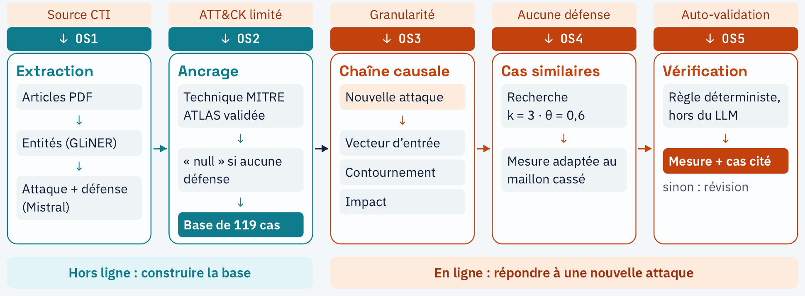
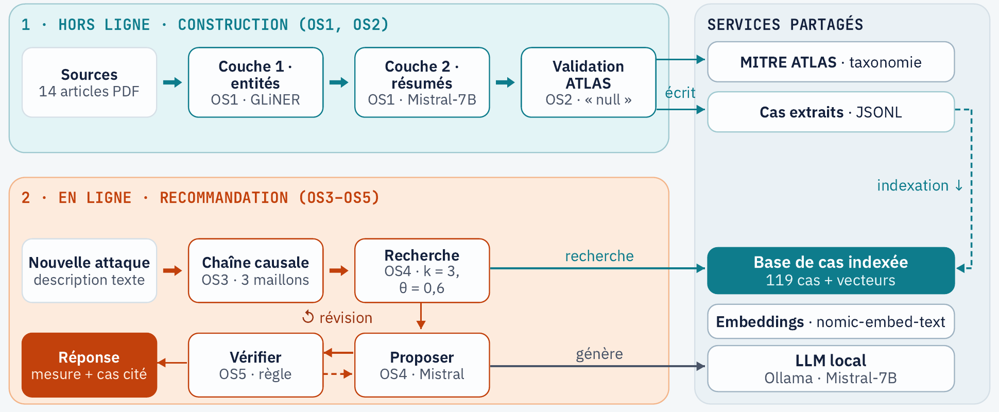

# Chapitre 4 — Objectifs et méthodologie

Le chapitre précédent a montré que les approches existantes couvrent séparément l'extraction de connaissances, la classification des attaques et la production de défenses, mais qu'aucune ne relie ces étapes pour les attaques visant les LLM, ni ne mesure ce que devient une erreur lorsqu'elle passe d'une étape à la suivante. Ce chapitre traduit ce positionnement en objectifs, puis décrit la manière dont CARL les réalise. La section 4.1 présente l'objectif général et les cinq objectifs spécifiques. La section 4.2 donne une vue d'ensemble du pipeline, en montrant comment chaque objectif devient une étape. La section 4.3 détaille l'architecture et la mise en œuvre de chacune de ces étapes.

## 4.1 Objectifs

### 4.1.1 Objectif général

L'objectif général de ce travail est de **concevoir et d'évaluer CARL, une approche qui transforme la littérature scientifique sur les attaques contre les LLM en recommandations de défense contextualisées, traçables et vérifiables**.

Chacun de ces trois qualificatifs a un sens précis. Une recommandation est *contextualisée* lorsqu'elle est adaptée à l'attaque étudiée, et non une défense générique valable pour toutes les attaques. Elle est *traçable* lorsqu'elle indique le cas, la technique MITRE ATLAS et l'article sur lesquels elle repose. Elle est *vérifiable* lorsqu'un contrôle, extérieur au modèle qui l'a produite, décide si elle est acceptée ou non. L'objectif comporte deux volets indissociables : concevoir l'approche, mais aussi évaluer chacune de ses étapes, afin de savoir ce que ces garanties valent réellement.

### 4.1.2 Objectifs spécifiques

L'objectif général se décompose en cinq objectifs spécifiques (OS). Chacun répond à l'une des limites de l'état de l'art identifiées au chapitre 3.

**OS1 — Extraire des articles l'attaque, son mécanisme et sa défense.** Les approches comme CTINexus, LADDER ou TechniqueRAG partent de rapports CTI, qui décrivent surtout des menaces informatiques classiques. Or les attaques contre les LLM sont aujourd'hui documentées principalement dans des articles scientifiques. Le premier objectif est donc d'extraire automatiquement de ces articles une description structurée de chaque attaque, de son mécanisme et, lorsqu'elle existe, de la défense proposée par les auteurs.

**OS2 — Ancrer chaque cas dans MITRE ATLAS, et enregistrer un « null » si aucune défense n'est documentée.** MITRE ATT&CK, utilisé par LADDER et TechniqueRAG, ne couvre pas les attaques propres aux LLM comme l'injection de prompt ou le *jailbreak*. Le deuxième objectif est de rattacher chaque attaque extraite à une technique de MITRE ATLAS dont l'identifiant a été vérifié. Il s'agit aussi de ne pas combler artificiellement une absence d'information : si un article ne propose aucune défense, le cas l'indique explicitement par une valeur « null » plutôt que par une défense inventée par le modèle.

**OS3 — Représenter l'attaque par sa chaîne causale.** Les approches étudiées décrivent les attaques par des entités isolées ou par une technique. Ce niveau de détail ne permet pas de dire où une défense doit agir. Le troisième objectif est de décrire chaque nouvelle attaque par une chaîne de trois maillons : le **vecteur d'entrée** (par où le contenu malveillant atteint le modèle), le **contournement** (comment il franchit les protections) et l'**impact** (ce que l'attaquant obtient).

**OS4 — Recommander une défense à partir de cas similaires et l'adapter.** CTINexus, LADDER et TechniqueRAG ne produisent aucune défense. Le quatrième objectif est de recommander une mesure en retrouvant, dans la base, les cas les plus proches de la nouvelle attaque, puis en adaptant leur défense à cette attaque, en précisant quel maillon de la chaîne la mesure vient casser.

**OS5 — Vérifier hors du LLM, citer la source et évaluer chaque étape.** Dans FALCON et Self-Refine, c'est le modèle qui a produit la réponse qui juge, au moins en partie, si elle est bonne. Or un modèle qui relit sa propre réponse a tendance à l'approuver (Xu et al., 2024 ; Kamoi et al., 2024). Le cinquième objectif répond à cette limite par trois exigences complémentaires :

- **vérifier hors du LLM** : la décision d'accepter ou de rejeter une recommandation est prise par une règle fixe, fondée sur des calculs de similarité et des seuils, et non par un modèle. La même recommandation reçoit donc toujours le même verdict, et ce verdict ne dépend pas de l'avis du modèle qui l'a écrite ;
- **citer la source** : chaque mesure recommandée doit indiquer le cas dont elle s'inspire, donc la technique ATLAS et l'article d'origine. Un analyste peut ainsi remonter à la source et contrôler la recommandation avant de l'appliquer ;
- **évaluer chaque étape** : au lieu de juger seulement la recommandation finale, on mesure séparément, sur les mêmes cas, la qualité de l'extraction, de la classification, de la recherche et de la recommandation. On peut alors savoir à quelle étape une erreur est apparue et comment elle s'est transmise aux étapes suivantes.

Le tableau 4.1 récapitule le lien entre chaque limite, l'objectif qui y répond et l'étape du pipeline qui le réalise.

*Tableau 4.1 — Des limites de l'état de l'art aux étapes de CARL*

| Limite de l'état de l'art | Objectif spécifique | Étape de CARL | Phase |
|---|---|---|---|
| Connaissances tirées de rapports CTI | OS1 | Extraction (GLiNER, puis Mistral-7B) | Hors ligne |
| ATT&CK ne couvre pas les attaques contre les LLM | OS2 | Ancrage dans MITRE ATLAS, « null » explicite | Hors ligne |
| Granularité insuffisante | OS3 | Chaîne causale de la nouvelle attaque | En ligne |
| Aucune défense produite | OS4 | Recherche de cas similaires et adaptation | En ligne |
| Contrôle confié au modèle générateur | OS5 | Vérification par une règle déterministe, citation du cas | En ligne |

### 4.1.3 Périmètre

Ces objectifs portent sur la conception de l'approche et sur la mesure de ce qu'elle garantit. Ils ne visent pas à couvrir l'ensemble des attaques contre les LLM : la base de cas est construite à partir d'un corpus de quatorze articles, centré sur l'injection de prompt et le *jailbreak*, et le chapitre 5 précise ce que cette taille permet ou non de conclure. Par ailleurs, la recherche complémentaire d'articles, utilisée lorsque la base ne contient aucun cas assez proche, est implémentée mais n'a pas été activée dans les expériences (section 4.3.8).

## 4.2 Pipeline global de CARL

### 4.2.1 Principe : le raisonnement à partir de cas

CARL repose sur le raisonnement à partir de cas (*Case-Based Reasoning*, CBR). Ce principe consiste à résoudre un nouveau problème en s'appuyant sur des problèmes déjà résolus, plutôt qu'en partant de zéro. Il est classiquement décrit comme un cycle en quatre étapes : retrouver les cas passés les plus semblables au nouveau problème (*Retrieve*), réutiliser leur solution (*Reuse*), la réviser pour l'adapter et la contrôler (*Revise*), puis conserver le nouveau cas pour les problèmes futurs (*Retain*) (Aamodt et Plaza, 1994).

Ce choix répond directement à la question de recherche. Un analyste qui doit protéger un système fondé sur un LLM ne cherche pas une défense générée librement par un modèle, mais une défense dont il puisse retrouver l'origine. Dans le raisonnement à partir de cas, toute solution proposée est rattachée à des cas existants, eux-mêmes tirés d'articles identifiés. La traçabilité n'est donc pas ajoutée après coup : elle découle du principe même de l'approche.

Dans CARL, un problème est une attaque contre un LLM, et sa solution est la défense documentée dans la littérature pour cette attaque. Chaque cas de la base réunit cinq éléments :

- un **résumé de l'attaque**, en une ou deux phrases ;
- l'**identifiant de la technique MITRE ATLAS** correspondante, vérifié, ou une abstention si aucun identifiant n'a pu être confirmé ;
- un **résumé de la défense**, ou la valeur « null » si l'article n'en propose aucune ;
- un **score de généralisabilité**, qui indique dans quelle mesure la défense peut s'appliquer en dehors du contexte où elle a été décrite ;
- la **source**, c'est-à-dire l'article dont le cas est extrait.

### 4.2.2 Deux phases : construire la base, puis répondre

Le pipeline de CARL se déroule en deux phases, présentées à la figure 4.1. Chaque colonne de la figure se lit de haut en bas : la limite de l'état de l'art, l'objectif spécifique qui y répond, puis l'étape qui le réalise.

*Figure 4.1 — Pipeline global de CARL : de chaque limite de l'état de l'art à l'étape qui y répond*

**La phase hors ligne construit la base de cas.** Elle est exécutée une seule fois pour un corpus donné, puis à nouveau lorsque de nouveaux articles sont ajoutés. Elle réalise OS1 et OS2.

- *Extraction (OS1).* Chaque article est découpé en passages. Un premier modèle, GLiNER, repère dans chaque passage les entités utiles : le vecteur d'entrée, le mécanisme de contournement, le modèle visé, l'impact, ou encore la défense citée. Un second modèle, Mistral-7B, s'appuie sur ces entités pour décider si le passage décrit une attaque concrète et, si c'est le cas, pour résumer l'attaque et la défense proposée.
- *Ancrage (OS2).* La technique attribuée à l'attaque est vérifiée dans MITRE ATLAS. Si l'article ne propose aucune défense, le cas reçoit la valeur « null » au lieu d'une défense inventée. Les cas validés forment la base de cas, dont la composition est présentée au chapitre 5.

**La phase en ligne répond à une nouvelle attaque.** Elle est exécutée pour chaque attaque soumise par un analyste, sous la forme d'une description en texte libre. Elle réalise OS3, OS4 et OS5.

- *Chaîne causale (OS3).* La nouvelle attaque est décrite par ses trois maillons : vecteur d'entrée, contournement et impact.
- *Recherche de cas similaires (OS4).* CARL retrouve dans la base les trois cas les plus proches de la nouvelle attaque, à condition que le plus proche dépasse un seuil de similarité. Le modèle propose alors une ou plusieurs mesures, chacune adaptée de la défense d'un cas retrouvé et associée au maillon qu'elle casse.
- *Vérification (OS5).* Une règle déterministe, qui ne fait appel à aucun modèle génératif, vérifie chaque mesure. Si elle est acceptée, elle est renvoyée avec le cas cité. Si elle est rejetée, le modèle reçoit les raisons du rejet et propose une version révisée, elle-même vérifiée par la même règle.

Les deux phases correspondent au cycle du raisonnement à partir de cas : la phase hors ligne prépare la mémoire de cas ; la phase en ligne en réalise les étapes *Retrieve* (recherche), *Reuse* (adaptation de la défense) et *Revise* (vérification et révision). L'étape *Retain* est prévue dans l'architecture, mais elle n'est exercée dans ce travail que pour la construction hors ligne de la base, puisque la recherche complémentaire qui ajouterait de nouveaux cas est désactivée (section 4.3.8).

## 4.3 Architecture et mise en œuvre

### 4.3.1 Vue d'ensemble

La figure 4.2 présente l'architecture de CARL. Elle reprend les deux phases du pipeline et fait apparaître les services partagés qu'elles utilisent.

*Figure 4.2 — Architecture de CARL : construction hors ligne, recommandation en ligne et services partagés*

Le premier bloc, en haut, est la **construction hors ligne** (OS1 et OS2). Les articles au format PDF passent par la couche 1 (GLiNER), qui extrait les entités, puis par la couche 2 (Mistral-7B), qui résume l'attaque et la défense. L'étape de validation vérifie la technique dans MITRE ATLAS et enregistre un « null » lorsqu'aucune défense n'est proposée. Les cas extraits sont écrits dans un fichier, puis indexés avec leurs vecteurs dans la base de cas.

Le second bloc, en bas, est la **recommandation en ligne** (OS3 à OS5). Une nouvelle attaque, décrite en texte libre, est représentée par sa chaîne causale. La recherche interroge la base de cas et retrouve les cas les plus proches. Le LLM local propose une mesure qui nomme le maillon qu'elle casse. La règle de vérification l'accepte ou la renvoie en révision. La réponse finale comprend la mesure et le cas cité.

À droite, les **services partagés** sont utilisés par les deux blocs : la taxonomie MITRE ATLAS, le fichier des cas extraits, la base de cas indexée, le modèle de plongements lexicaux (*embeddings*) `nomic-embed-text` et le LLM local Mistral-7B, servi par Ollama. Tous les modèles sont exécutés localement : aucune donnée n'est envoyée à un service externe.

Les sections suivantes décrivent chaque composant, dans l'ordre du traitement.

### 4.3.2 Prétraitement des articles

Le texte de chaque article est extrait du PDF, puis nettoyé : les mots collés par l'extraction sont repérés et la bibliographie est retirée. Ce dernier point est important, car une bibliographie contient de nombreux noms d'auteurs et de systèmes qui seraient sinon pris pour des entités.

Le texte est ensuite découpé en passages (*chunks*) d'environ 3 000 caractères, avec un chevauchement de 200 caractères entre deux passages consécutifs. Le découpage permet de respecter la taille d'entrée des modèles, et le chevauchement évite qu'une entité soit coupée en deux à la frontière entre deux passages. La position de départ de chaque passage dans le texte original est conservée, ce qui permet de retrouver à tout moment l'endroit exact de l'article d'où provient une information.

### 4.3.3 Couche 1 : extraction des entités

La couche 1 extrait les entités de chaque passage avec GLiNER (modèle `urchade/gliner_multi-v2.1`). GLiNER est un extracteur d'entités nommées (*Named Entity Recognition*, NER) dit *zero-shot* : on lui fournit la liste des catégories recherchées, sans entraînement spécifique, et il renvoie les segments du texte qui correspondent à ces catégories. Une entité n'est retenue que si son score de confiance atteint 0,4.

Les catégories recherchées forment une taxonomie de sept étiquettes propres aux attaques contre les LLM :

- le vecteur d'entrée ;
- le mécanisme de contournement ;
- le modèle LLM ciblé ;
- l'impact sur le modèle ;
- l'application ou le service intégrant un LLM ;
- la défense ou le garde-fou cité ;
- le nom du système ou de l'attaque proposé par les auteurs.

Les quatre premières étiquettes correspondent aux axes d'analyse d'une attaque. Les trois dernières désignent des éléments concrets, souvent des noms propres, qui rendent un cas identifiable et qui servent ensuite au calcul du score de généralisabilité.

Une difficulté pratique est apparue lors du développement : GLiNER ne lit qu'un nombre limité de jetons, et tronque sans avertissement la suite d'une entrée trop longue. Avec des passages de 3 000 caractères, environ un tiers de chaque passage n'était jamais lu. Chaque passage est donc lui-même parcouru par fenêtres de 200 mots, avec un chevauchement de 30 mots, afin qu'aucune partie du texte ne soit ignorée.

Une alternative a été étudiée : demander directement à Mistral-7B, par un prompt, d'extraire les entités. Cette approche est exposée à des erreurs qu'un extracteur comme GLiNER ne commet pas, car le modèle génère du texte au lieu de sélectionner un segment existant. Nous avons donc développé quatre filtres de validation, chacun visant une erreur observée pendant le développement :

1. une **liste blanche d'étiquettes**, qui rejette toute catégorie absente de la taxonomie ;
2. une **longueur maximale**, car les entités de ce domaine sont courtes et un segment très long indique que le modèle a recopié une phrase descriptive ;
3. un **filtre de fuite de l'exemple**, qui supprime toute entité reprenant littéralement une valeur de l'exemple donné dans le prompt ;
4. un **filtre des valeurs de remplissage**, qui rejette les textes du type « non spécifié » utilisés à la place d'une véritable absence.

Le choix final de GLiNER pour la couche 1 repose sur la comparaison des deux méthodes et sur la mesure de la contribution de chaque filtre, présentées à la section 5.4. Les entités extraites ne sont pas abandonnées après cette étape : elles sont transmises à la couche 2 comme contexte.

### 4.3.4 Couche 2 : résumé de l'attaque et de la défense

Pour chaque passage, accompagné de ses entités, un second appel à Mistral-7B (version `Mistral-7B-Instruct-v0.3`) produit un enregistrement structuré qui indique :

- si le passage décrit une attaque concrète ;
- un résumé de l'attaque en une ou deux phrases ;
- un résumé de la défense, ou une valeur « null » explicite si le passage n'en propose aucune ;
- un niveau de confiance.

Le prompt impose que ces résumés reposent sur le texte du passage et sur ses entités, et non sur les connaissances générales du modèle. Les mêmes règles que pour la couche 1 s'appliquent : aucune étiquette inventée et aucune valeur de remplissage à la place de « null ». Le modèle est utilisé avec une température de 0,1, ce qui limite la variabilité des réponses.

Les sorties brutes de chaque passage sont enregistrées avant toute agrégation. Il est ainsi possible d'examiner la qualité de l'extraction indépendamment des étapes qui l'utilisent ensuite, ce qui est indispensable pour mesurer la propagation des erreurs.

### 4.3.5 Validation de la technique MITRE ATLAS

MITRE ATLAS compte environ 84 techniques réparties en 16 tactiques (MITRE ATLAS). Plutôt que de laisser le modèle choisir librement parmi toutes ces techniques, CARL lui présente une liste restreinte de candidats liés aux LLM : injection de prompt directe, indirecte et déclenchée, *jailbreak*, obfuscation de prompt, extraction du prompt système, fuite de données, empoisonnement d'un système RAG ou du contexte d'un agent, entre autres. Ce principe reprend l'idée de TechniqueRAG, appliquée ici à MITRE ATLAS. Le prompt rappelle aussi la différence entre des techniques voisines, par exemple entre un *jailbreak*, qui vise le modèle lui-même, et une injection de prompt, qui détourne une application intégrant un LLM.

L'identifiant proposé par le modèle est ensuite contrôlé en deux temps :

1. il doit être bien formé et correspondre à une technique qui existe réellement dans MITRE ATLAS, ce qui écarte les identifiants inventés ;
2. il doit appartenir à la liste des techniques liées aux LLM, ce qui écarte les identifiants réels mais sans rapport avec le cas.

Seul un identifiant qui passe ces deux contrôles est conservé. Sinon, le cas reçoit une abstention. Un point est essentiel : un échec de validation ne supprime pas le cas. Le résumé de l'attaque et celui de la défense sont conservés, car une erreur de classification ne prouve pas que le contenu extrait soit lui-même faux.

Passer ces deux contrôles montre qu'un identifiant est *valide*, c'est-à-dire bien formé et plausible pour le domaine ; cela ne montre pas qu'il est *correct* pour le cas considéré. La section 5.5 mesure l'écart entre les deux.

### 4.3.6 Score de généralisabilité

Chaque cas qui possède une défense reçoit un score de généralisabilité. Ce score indique si la défense est décrite en termes de mécanismes généraux, applicables à d'autres systèmes, ou si elle dépend d'un produit ou d'un fournisseur particulier.

Plutôt que de demander ce jugement au modèle, ce qui le rendrait difficile à reproduire, le score est calculé par une formule simple. On compte le nombre de noms distincts de fournisseurs, de produits ou d'écosystèmes propriétaires, repérés par la couche 1, qui apparaissent dans le texte de la défense. Le score vaut :

> g = 1 / (1 + nombre de produits ou fournisseurs nommés dans la défense)

Une défense formulée uniquement en termes de mécanismes généraux obtient donc g = 1. Une défense liée à un outil propriétaire obtient un score plus faible. Un cas dont la défense est « null » ne reçoit pas de score : aucun jugement n'est inventé pour une défense qui n'a pas été extraite.

### 4.3.7 Déduplication et construction de la base de cas

Un article de recherche reformule souvent son sujet à plusieurs endroits : introduction, état de l'art, discussion et conclusion. Sans précaution, chacune de ces reformulations deviendrait un cas distinct. Lors du développement, sur l'article de Greshake et al. (2023), la plupart des passages étaient ainsi marqués comme décrivant une attaque, avec la même technique et des résumés qui étaient des paraphrases les uns des autres : il s'agissait d'une seule attaque, décrite plusieurs fois.

Pour éviter cette redondance, CARL conserve au plus trois cas par couple (article source, technique ATLAS), en gardant les plus spécifiques, c'est-à-dire ceux dont le résumé contient le plus d'entités concrètes. Cette déduplication est appliquée avant le calcul des vecteurs, ce qui évite aussi des appels inutiles au modèle de plongements.

Chaque cas retenu est ensuite enregistré dans la base avec un identifiant unique, sa source, le résumé de l'attaque, la technique ATLAS et son nom, le résumé de la défense, le score de généralisabilité et le niveau de confiance. La base est stockée dans un fichier au format JSONL (une ligne par cas), ce qui permet de la relire, de la corriger ou de la compléter facilement.

Le résumé de l'attaque et celui de la défense sont transformés séparément en vecteurs avec le modèle `nomic-embed-text`. Ils sont séparés parce qu'ils ne servent pas au même moment : la recherche compare les attaques entre elles, tandis que la vérification compare une mesure proposée à la défense d'un cas. La base grandit de manière incrémentale : lorsqu'un nouvel article est traité, ses cas sont ajoutés sans reconstruire les autres.

### 4.3.8 Recherche des cas similaires

Lorsqu'une nouvelle attaque est soumise, elle passe d'abord par les mêmes couches 1 et 2 que les articles, ce qui produit un résumé de l'attaque et, si possible, un identifiant ATLAS validé. La recherche se déroule ensuite comme suit :

1. si l'attaque a un identifiant validé, seuls les cas de la même technique sont considérés ; si la base n'en contient aucun, toute la base est utilisée ;
2. chaque cas candidat reçoit un score égal à la similarité cosinus entre son résumé d'attaque et celui de la nouvelle attaque, augmentée d'un bonus α = 0,05 lorsque les deux techniques coïncident ;
3. les k = 3 cas les mieux classés sont retenus, à condition que le meilleur dépasse le seuil θ = 0,6.

Le filtre par technique est un choix de conception, et non un paramètre ajusté. L'effet de α et de θ est analysé à la section 5.6. Un meilleur score au-dessus de θ est censé signifier que la base *couvre* la nouvelle attaque, ce que l'évaluation vérifie.

L'architecture prévoit aussi un niveau de recherche secondaire, utilisé lorsque aucun cas n'atteint le seuil : une requête est construite à partir des éléments de l'attaque (famille de modèle visée, mécanisme de contournement, technique), des articles sont recherchés dans des bases académiques (Semantic Scholar, arXiv), traités par la phase hors ligne et ajoutés à la base avant une nouvelle recherche. Ce niveau est implémenté et paramétrable, mais il est **désactivé dans toutes les expériences de ce travail** : les cas où le seuil n'est pas atteint sont seulement enregistrés. Ce choix permet d'évaluer le pipeline principal indépendamment de toute recherche en ligne.

### 4.3.9 Chaîne causale, proposition et adaptation

À partir des cas retrouvés, la recommandation est produite par une boucle « proposer, vérifier, réviser ».

Avant de proposer, le modèle décrit la nouvelle attaque par sa chaîne causale de trois maillons : vecteur d'entrée, contournement et impact (OS3). Cette description sert ensuite à deux choses : orienter l'adaptation de la défense et permettre de vérifier que la mesure agit bien sur l'attaque.

L'étape *proposer* demande au modèle une ou plusieurs mesures, fondées uniquement sur les défenses des cas retrouvés. Chaque mesure doit :

- citer le cas dont elle s'inspire ;
- adapter la défense de ce cas à la nouvelle attaque, au lieu de la recopier ;
- indiquer le maillon de la chaîne causale qu'elle casse.

Citer un cas est obligatoire. Lorsque le modèle omet la citation, CARL attribue la mesure au cas dont la défense est la plus proche, et la signale comme *citation inférée*. Elle est alors soumise aux mêmes contrôles qu'une mesure citée normalement.

Deux propriétés supplémentaires sont relevées pour chaque mesure : l'*adaptation*, lorsque la mesure mentionne un élément de la nouvelle attaque absent de la défense citée, et l'*adéquation causale*, lorsque le maillon indiqué existe dans la chaîne et que la mesure lui est proche.

### 4.3.10 Vérification par une règle déterministe

La vérification est le point central de l'approche. Elle n'est pas confiée à un modèle, mais à une règle déterministe qui s'applique aux cas retrouvés. La séparation entre génération et vérification est donc structurelle : contrairement à un modèle qui relirait sa propre réponse, une règle ne peut pas présenter le biais d'auto-évaluation observé dans les approches de type Self-Refine (Xu et al., 2024 ; Kamoi et al., 2024). Deux formes de vérification ont été mises en œuvre.

**La vérification lexicale.** C'est la première forme développée. Une mesure est acceptée si elle cite un cas retrouvé et si au moins 60 % de ses mots de contenu figurent dans la défense de ce cas. Cette règle garantit l'ancrage de la mesure dans un cas, mais elle a un défaut : elle récompense la recopie d'une défense existante plutôt que son adaptation à la nouvelle attaque. C'est ce défaut qui a conduit à la seconde forme.

**La vérification causale.** Elle reste une règle déterministe et ne fait aucun appel à un modèle génératif. Elle compare des vecteurs obtenus avec `nomic-embed-text`. Une mesure est acceptée si :

1. elle cite un cas retrouvé dont la défense n'est pas « null » ;
2. sa similarité cosinus avec la défense de ce cas est d'au moins 0,70 ;
3. sa similarité cosinus avec le maillon qu'elle prétend casser est d'au moins 0,50.

Ces deux seuils ont d'abord été fixés a priori, puis calibrés sur la base de cas ; les valeurs calibrées et leurs limites sont présentées à la section 5.7.

Si une mesure est rejetée, les raisons du rejet sont transmises au modèle, qui propose une version révisée ; celle-ci est vérifiée par la même règle. La boucle s'arrête lorsque la mesure est acceptée ou après un nombre maximal d'itérations, fixé à une révision (N = 1) dans nos expériences. Le nombre d'itérations et le verdict final accompagnent chaque recommandation.

Pour mesurer ce qu'apporte ce choix, l'évaluation compare la vérification causale à plusieurs variantes : la même règle sans l'étiquette de maillon donnée par le modèle, un juge LLM utilisant le même modèle Mistral-7B, et une boucle de type Self-Refine où le modèle critique et révise sa propre réponse. Ces comparaisons sont présentées à la section 5.7.

Une mesure qui passe la vérification est *traçable*, ce qui ne garantit pas qu'elle soit une *bonne défense*. L'écart entre les deux est l'objet de la section 5.7.

### 4.3.11 Environnement de mise en œuvre

CARL est implémenté en Python. Le tableau 4.2 récapitule les composants, les outils utilisés et leurs principaux paramètres.

*Tableau 4.2 — Composants, outils et paramètres de CARL*

| Composant | Outil ou modèle | Paramètres principaux |
|---|---|---|
| Extraction du texte | Extraction PDF et nettoyage | Bibliographie retirée ; passages de 3 000 caractères, chevauchement de 200 |
| Couche 1 : entités | GLiNER (`urchade/gliner_multi-v2.1`) | 7 étiquettes ; seuil de confiance 0,4 ; fenêtres de 200 mots, chevauchement de 30 |
| Couche 2 : résumés | Mistral-7B-Instruct-v0.3 via Ollama | Température 0,1 ; « null » explicite |
| Validation ATLAS | Taxonomie MITRE ATLAS | Liste restreinte aux techniques liées aux LLM ; double contrôle ; abstention sinon |
| Base de cas | Fichier JSONL et vecteurs | Au plus 3 cas par (article, technique) ; vecteurs séparés attaque et défense |
| Plongements | `nomic-embed-text` via Ollama | Similarité cosinus |
| Recherche | Règle de classement | Filtre par technique ; α = 0,05 ; k = 3 ; θ = 0,6 ; niveau secondaire désactivé |
| Proposition et révision | Mistral-7B-Instruct-v0.3 via Ollama | Chaîne causale à 3 maillons ; citation obligatoire ; N = 1 révision |
| Vérification | Règle déterministe, sans modèle génératif | Lexicale : 60 % ; causale : 0,70 (défense) et 0,50 (maillon), puis calibrées |

Le même modèle, Mistral-7B, réalise donc l'extraction guidée par prompt, les résumés de la couche 2 et les étapes *proposer* et *réviser*. Ce choix est volontaire : il permet de comparer, à modèle constant, une vérification par une règle et une vérification par le modèle lui-même. Le seul cas où Mistral-7B joue le rôle de vérificateur est la variante « juge LLM », utilisée comme point de comparaison.

## 4.4 Conclusion

Ce chapitre a traduit le positionnement de CARL en un objectif général et cinq objectifs spécifiques, chacun répondant à une limite de l'état de l'art. Il a montré comment ces objectifs deviennent les étapes d'un pipeline en deux phases : une construction hors ligne, qui extrait des articles une base de cas ancrée dans MITRE ATLAS, et une recommandation en ligne, qui décrit une nouvelle attaque par sa chaîne causale, retrouve les cas les plus proches, adapte leur défense et la vérifie par une règle extérieure au modèle.

Il a aussi fait apparaître que chacun des trois mécanismes de contrôle du pipeline vérifie une propriété plus facile que celle qui est réellement recherchée : un identifiant valide plutôt que correct, un cas proche plutôt que pertinent, une mesure traçable plutôt qu'efficace. Le chapitre suivant évalue CARL étape par étape, en mesurant pour chacun de ces mécanismes l'écart entre ce qu'il vérifie et ce qu'il est censé garantir, puis la manière dont les erreurs se propagent d'une étape à l'autre.
